# 1. ICMP y primer contacto con Wireshark.
## Primera parte.

#### a) ¿Qué es ICMP y para qué se usa? ¿Transporta datos de aplicaciones como lo hacen TCP o UDP?

El ICMP (Internet Connection Message Protocol) como lo dice su nombre es un protocolo. El objetivo es proporcionar un medio para trnasferir mensajes desde los dispositivos de encaminamiento y otros computadores. Proporciona  información de retroalimentación sobre los (posibles) problemas relacionados en la comunicación.  
ICMP no está involucrado en el trnasporte de datos activamente como TCP o UDP, está involucrado en la retroalimentación de esos datos.

#### b) ¿Qué relación tiene con IP? ¿Viaja dentro de IP, al lado de IP o debajo de IP? ¿Cómo sabe el receptor que el contenido de un paquete IP es ICMP?

Se dice que los mensajes *ICMP* son usuarios de *IP* porque se encapsulan en la cabecera de esta ultima. El receptor sabe que el contenido es un paquete ICMP por que en la cabecera existe una distinción sobre el tipo de protocolo.  
Para IPv4 los mas relevantes son: 

| Valor del campo | Protocolo | 
|   ---           |   ---     |
|  1              | ICMP      |   
|  6              |   TCP     | 
|  17             | UDP       | 

#### c) ¿Qué hace ping? ¿Qué son un Echo Request y un Echo Reply? ¿Qué campos de ICMP permiten distinguirlos?

Un `ping` es un comando que envia un conjunto de paquetes y espera activamente un *ACK*, ademas que toma el tiempo que les toma devolver el ACK.

`Echo Request` y `Echo Reply` son un tipo de mensaje ICMP usados como mecanismo para corroborar si la conexión entre dos dispositivos es posible. El receptor del *Echo Request* está obligado a responder con un mensaje *Echo Reply*. Se distingen los tipos de mensaje mediante el **tipo**, que es el campo de la cabecera usada para esto.

#### d) ¿Qué información mínima contiene un mensaje ICMP de tipo Echo?

Un mensaje ICMP Echo tiene como minimo un ID que identifica la sesión del host origen que genera las solicitudes y el numero de secuencia que es un contador que incrementa con cada solicitud de eco de una misma sesión. Ademas de los campos de Tipo, Código y Suma de comprobación que forman parte de todos los tipos de mensaje ICMP.  
Un mensaje de tipo Echo se conforma de esta forma: 

```text
0               8               16                              31
+-+-+-+-+-+-+-+-+-+-+-+-+-+-+-+-+-+-+-+-+-+-+-+-+-+-+-+-+-+-+-+-+
|     Tipo      |    Código     |     Suma de comprobación      |
+-+-+-+-+-+-+-+-+-+-+-+-+-+-+-+-+-+-+-+-+-+-+-+-+-+-+-+-+-+-+-+-+
|         Identificador         |      Número de secuencia      |
+-+-+-+-+-+-+-+-+-+-+-+-+-+-+-+-+-+-+-+-+-+-+-+-+-+-+-+-+-+-+-+-+
|                        Datos opcionales                       |
+-+-+-+-+-+-+-+-+-+-+-+-+-+-+-+-+-+-+-+-+-+-+-+-+-+-+-+-+-+-+-+-+
```
## Segunda Parte (Uso de Wireshark)

Dejamos registro del procedimeinto previo a responder la segunda parte de la consigna 1.

`ip address` e `ip route`

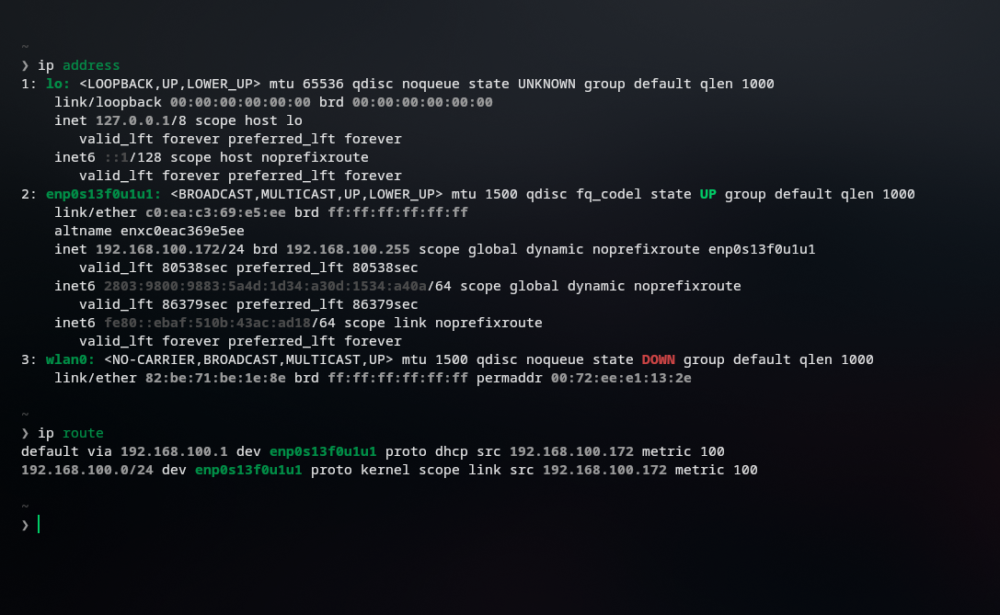
---
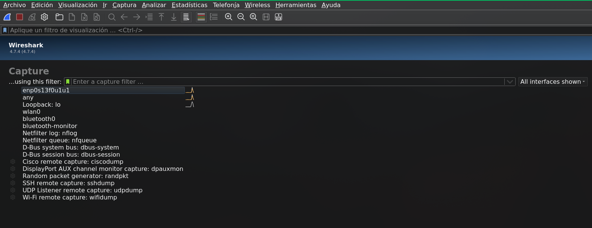
--- 
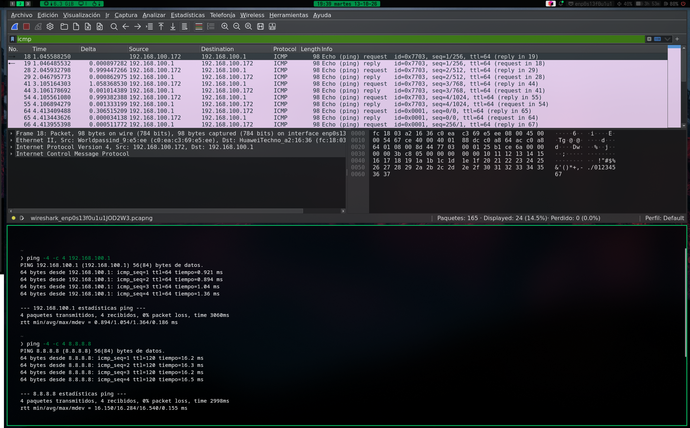
---

Tenemos entonces: 
- Interfáz : enp0s13f0u1u1
- Dirección IPv4: 192.168.100.172
- Máscara de subred: 255.255.255.0
- Gateway: 192.168.100.1
- MAC: c0:ea:c3:69:e5:ee

#### Tabla 

En respuesta a : "Seleccionar un Echo Request y desplegar el panel de detalles (el del medio). Identificar las capas que muestra Wireshark y completar una tabla como esta:"

| Capa (como la nombra Wireshark)|Dirección/identificador origen|Dirección/identificador destino|¿Qué campo indica qué protocolo viene "adentro"? | 
| :---                           |              :---            | :---                          | :---                                            |
| Ethernet II    |`Worldpassind_9:e5:ee (c0:ea:c3:69:e5:ee)`|`HuaweiTechno_a2:16:36 (fc:18:03:a2:16:36)`      |  El campo `Type` con el valor `IPv4` (0x0800)|  
| Internet Protocol Version 4    | `192.168.100.172`            |          `192.168.100.1`      | El `Protocol` inidca que protocolo viene, con el valor `ICMP (1)` | 
| Internet Control Message Protocol|            -               |      -                | *No aplica (No hay protocolo)*                 |
| Datos / payload                |          *No aplica*         |        *No aplica*            |  *No aplica (No hay protocolo)*                  | 

---

#### a) La MAC destino del Echo Request enviado a 8.8.8.8, ¿es la MAC de 8.8.8.8? ¿De qué equipo es? Compárenla con la MAC destino del ping al gateway. ¿Qué conclusión sacan sobre el alcance de una dirección MAC frente al de una dirección IP?
No, la MAC destino del Echo Request enviado (a 8.8.8.8) no es la MAC de 8.8.8.8. sino la del router. El paquete 92 tiene como direccion de destino por `fc:18:03:a2:16:36` pero comparandolo con el paquete 41, ping al gateway, vemos que son iguales:
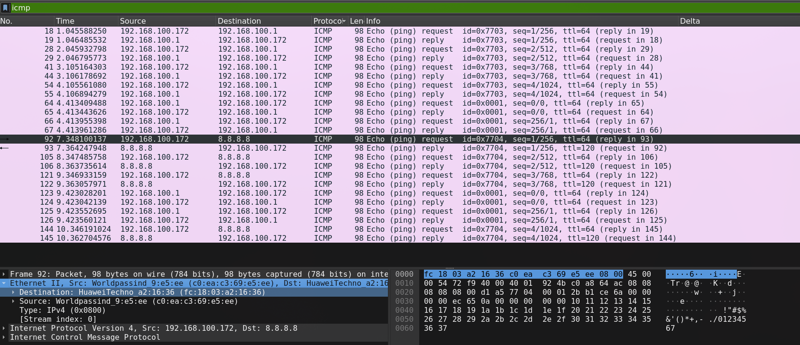
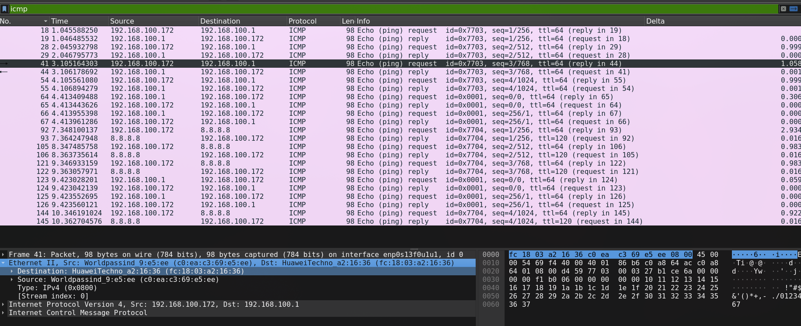

Concluimos lo hablado en clases, el alcance de una MAC es hasta el gateway y solo sireve para comunicarnos entre redes locales, en su contraparte con la dirección IP que tiene un alcance, mediante el gateway, mayor.

#### b) Comparen un Echo Request con su Echo Reply (Wireshark los vincula en el campo [Response frame:...]). Hagan una lista de los campos que cambian y de los que se mantienen en Ethernet, IP e ICMP. ¿Por qué tiene sentido cada cambio? ¿Por qué el identificador y el número de secuencia se mantienen?

Tomemos los paquetes 41 y 44. 
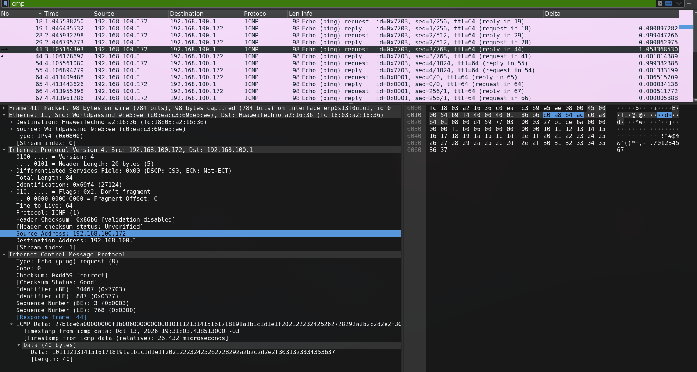 
---
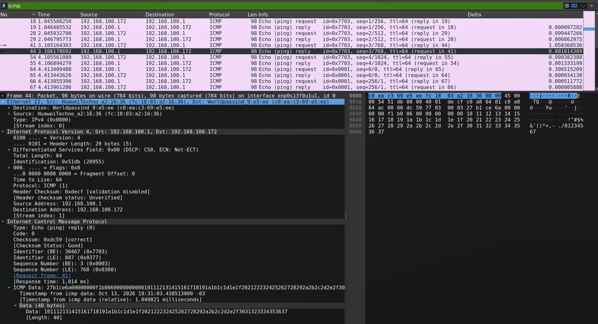

Diferencias:
- Ethernet II: Direcciones de origen y destino. Completamente coherente, uno es el envio y el otro la respuesta.

- IPv4: Misma explicación que antes.

- Checksum: Cambia porque paso de 8 a 0.

- Timestamps: Como es de esperar, se registran por milemimas de segundos de diferencia pero cambian.


Los identificadores y numero de secuencia no cambian porque sino pierde el punto todo el protocolo, no habría forma de relacionar si un paquete es una respuesta.

#### c) ¿Dónde está el payload de ping? ¿Cuántos bytes tiene y qué contiene? ¿Es igual en el Reply? Si en el grupo hay una computadora con Windows y otra con Linux, compárenlos: ¿qué les sugiere que sean distintos?

El payload está en `Interet Control Message Protocol > ICMP Data > Data` Tiene 40 bytes y en la segunda captura podemos ver su contenido.

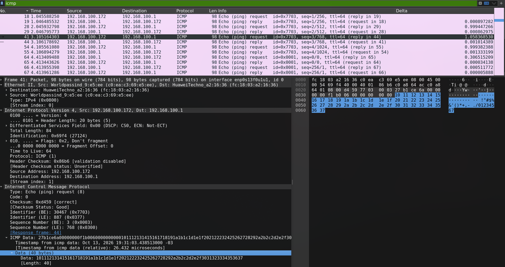


Contenido del payload.

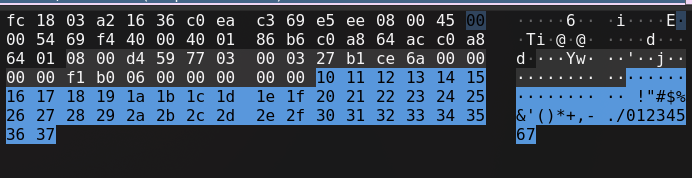 

En comparación con su reply, vemos que son iguales

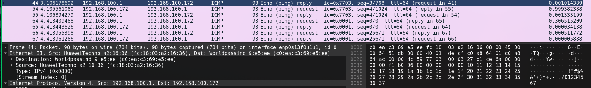

En clase vimos la explicación de porque cambian los payloads entre sistemas operativos y es porque al fin y al cabo es alguien o un grupo de personas los que diseñaron las cargas de los pings y en realidad la carga no tiene importancia, lo que se busca es probar la conectividad entre dispositivos, lo mas util que puede llevar es un timestamp. 

#### d) ¿Qué valor de TTL tiene el Echo Request que ustedes enviaron? ¿Y el Reply que llegó de 8.8.8.8? ¿Por qué no son iguales? (Pista: investiguen qué hace un router con el TTL.)


Vemos en la ultima columna los valores


TTL Echo Request: 64   
TTL Echo Reply: 120

El TTL (Time to Live) no es parametro que se comparta, como su nombre indica es una cantidad para que el paquete se descarta y quien descuenta es el router, en cada salto resta al TTL y recalcula el checksum, si llega a cero manda ICMP Time Exceeded.

#### e) Dibujen la encapsulación del paquete que eligieron como "cajas dentro de cajas", indicando para cada caja qué tamaño en bytes tiene según Wireshark.

Capturas de Wireshark mostrnado el tamaño de cada encabezado.  
  
  
  
  


FINALMENTE

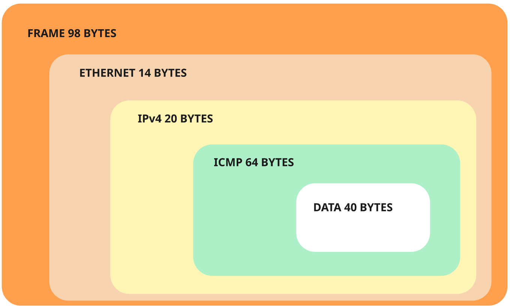