**Redes de Computadoras**

**FACULTAD DE CIENCIAS EXACTAS, FÍSICAS Y NATURALES — UNIVERSIDAD NACIONAL DE CÓRDOBA**

# Trabajo Final Integrador

## Control de una Smart Home con broker MQTT en servidor doméstico

| Nombre | Apellido | Legajo |
|---|---|---|
| Samuel Agustín | Abel | 45487903 |
| Mauricio | Andres | 46033101 |
| Valentín | Suppo | 45591758 |
| Leandro Dante | Bassi | 45654434 |
| Agustín Fernando | Bolatti | 44230937 |
| Branko Uriel | Levang | 44284938 |
| Lautaro Ezequiel | Perez Cadiboni | 45107672 |

**Año:** 2026

---

## Índice

1. Introducción
   - 1.1 Objetivos
   - 1.2 Motivación y arquitectura general
2. Infraestructura de la red local doméstica (LAN)
   - 2.1 Topología y dispositivos de red
   - 2.2 Direccionamiento y encaminamiento
3. Home Server como núcleo de la casa inteligente
   - 3.1 Rol y funciones del Home Server
   - 3.2 Topología local (Edge Computing) frente a topología Cloud
   - 3.3 Tolerancia a fallos, modo offline y resiliencia en la LAN
4. Protocolos de comunicación IoT
   - 4.1 Protocolo MQTT y modelo de publicación/suscripción
   - 4.2 Comparación entre MQTT y HTTP en aplicaciones IoT
   - 4.3 Funcionamiento interno y mensajes de MQTT
   - 4.4 Calidad de servicio (QoS) en MQTT
5. Trazabilidad en el modelo TCP/IP
   - 5.1 Mapeo de la Smart Home en el modelo TCP/IP
   - 5.2 Recorrido de una orden
6. Seguridad perimetral y filtrado de tráfico
   - 6.1 Seguridad en la capa de transporte (TLS)
   - 6.2 Autenticación y control de acceso en el broker
   - 6.3 Segmentación y filtrado de red
   - 6.4 Acceso remoto: conexión entre la LAN y la WAN
7. Implementación práctica
   - 7.1 Arquitectura física
   - 7.2 Equipos seleccionados
   - 7.3 Software del Home Server
   - 7.4 Presupuesto estimado
   - 7.5 Justificación de la solución
8. Conclusiones
9. Bibliografía
- Anexo A — Cálculo del overhead de HTTP y MQTT
- Anexo B — Ejemplos de configuración
- Anexo C — Glosario de siglas
- Anexo D — Fuentes de los precios

---

# 1. INTRODUCCIÓN

En la actualidad, las tecnologías digitales y los nuevos sistemas de comunicación permiten controlar distintos dispositivos de la vida cotidiana mediante una red Wi-Fi doméstica. Encender una lámpara, bajar una persiana o activar una alarma desde una aplicación en el celular son ejemplos cada vez más comunes de lo que se conoce como casa inteligente o *Smart Home*.

Estos dispositivos se comunican a través de una red local, lo que les permite intercambiar información y recibir órdenes de manera sencilla para el usuario. Dentro de esta arquitectura, un servidor doméstico o *Home Server* puede actuar como punto central de control y coordinación de los distintos dispositivos conectados.

Para establecer la comunicación entre el servidor y los dispositivos se pueden utilizar distintos protocolos. En este trabajo se analiza en particular MQTT, un protocolo de mensajería ampliamente utilizado en sistemas IoT por su bajo consumo de recursos y su modelo de comunicación basado en publicación y suscripción.

A partir de los conceptos vistos en Redes de Computadoras, se analiza:

- cómo se estructura una red de este tipo;
- cómo se identifican y comunican los distintos dispositivos;
- qué ocurre desde que un usuario selecciona una acción en su celular hasta que, por ejemplo, una lámpara recibe la orden de encenderse.

Finalmente, se propone una implementación concreta que puede replicarse en cualquier vivienda: se mantienen el router existente y dispositivos comerciales estándar (lámparas, enchufes y sensores), y se reemplaza el sistema que los controla (un asistente como Alexa o la aplicación en la nube del fabricante) por un Home Server armado con una computadora propia y software libre.

## 1.1. Objetivos

- Describir la estructura de una red local doméstica y la función de los principales dispositivos que la componen.
- Explicar el funcionamiento de un Home Server y su función como elemento central dentro de una casa inteligente.
- Analizar el direccionamiento IP y el encaminamiento de los paquetes entre los distintos dispositivos y redes involucradas.
- Explicar el funcionamiento del protocolo MQTT, su modelo de publicación/suscripción y la función del broker.
- Comparar brevemente MQTT con HTTP, para justificar por qué MQTT resulta conveniente en este escenario.
- Comparar la comunicación con un broker MQTT local, alojado en el Home Server, frente al uso de un broker en la nube.
- Analizar qué ocurre ante la pérdida de conectividad a Internet y qué funciones de la casa siguen operando dentro de la red local.
- Relacionar los protocolos y mecanismos utilizados con las capas del modelo TCP/IP.
- Analizar el recorrido de una orden desde un dispositivo de usuario, como un celular, hasta un dispositivo IoT de la vivienda.
- Analizar los mecanismos de seguridad necesarios para proteger el broker y los dispositivos IoT, considerando autenticación, control de acceso, cifrado mediante TLS y segmentación de la red.
- Proponer una implementación por etapas, con el router existente, dispositivos comerciales estándar y un Home Server propio con software libre, seleccionando los equipos y estimando su costo.

## 1.2. Motivación y arquitectura general

La elección de una casa inteligente basada en un Home Server y el protocolo MQTT surge de la creciente incorporación de dispositivos conectados a las actividades cotidianas. Los equipos dejan de funcionar de manera aislada y pasan a formar parte de redes donde intercambian información, reciben órdenes y se comunican con servidores y otros dispositivos. Esta transformación está directamente relacionada con el desarrollo de las tecnologías IoT (*Internet of Things*, Internet de las Cosas).

Desde el punto de vista de las comunicaciones de datos, una casa inteligente es un escenario completo para analizar cómo se transmite la información desde un dispositivo de usuario hasta un dispositivo final. En ese recorrido intervienen el direccionamiento IP, las redes locales, el encaminamiento, los routers, los servidores y los protocolos de comunicación.

Además, la mayoría de los productos comerciales de domótica dependen de servidores del fabricante en Internet. Una lámpara inteligente controlada por Alexa, por ejemplo, recibe la orden desde la nube, aunque el celular y la lámpara estén en la misma habitación. Muchos de estos dispositivos ya usan MQTT, pero contra un broker ubicado en los servidores del fabricante. Un Home Server permite estudiar la alternativa: **se conservan los dispositivos y se trae el broker a la casa**, de modo que los servicios se gestionan dentro de la propia red doméstica, con protocolos abiertos.

La Figura 1.1 resume la arquitectura que se analiza en este trabajo:

- el router existente de la casa da salida a Internet y Wi-Fi a los usuarios;
- el Home Server reemplaza al asistente o a la nube del fabricante: concentra el broker MQTT, las automatizaciones y la seguridad;
- los dispositivos comerciales Zigbee (lámpara y sensores) se comunican con el Home Server a través de un coordinador USB;
- opcionalmente, los dispositivos Wi-Fi quedan en una red propia, separada de la red de los usuarios, a la que solo accede el Home Server.

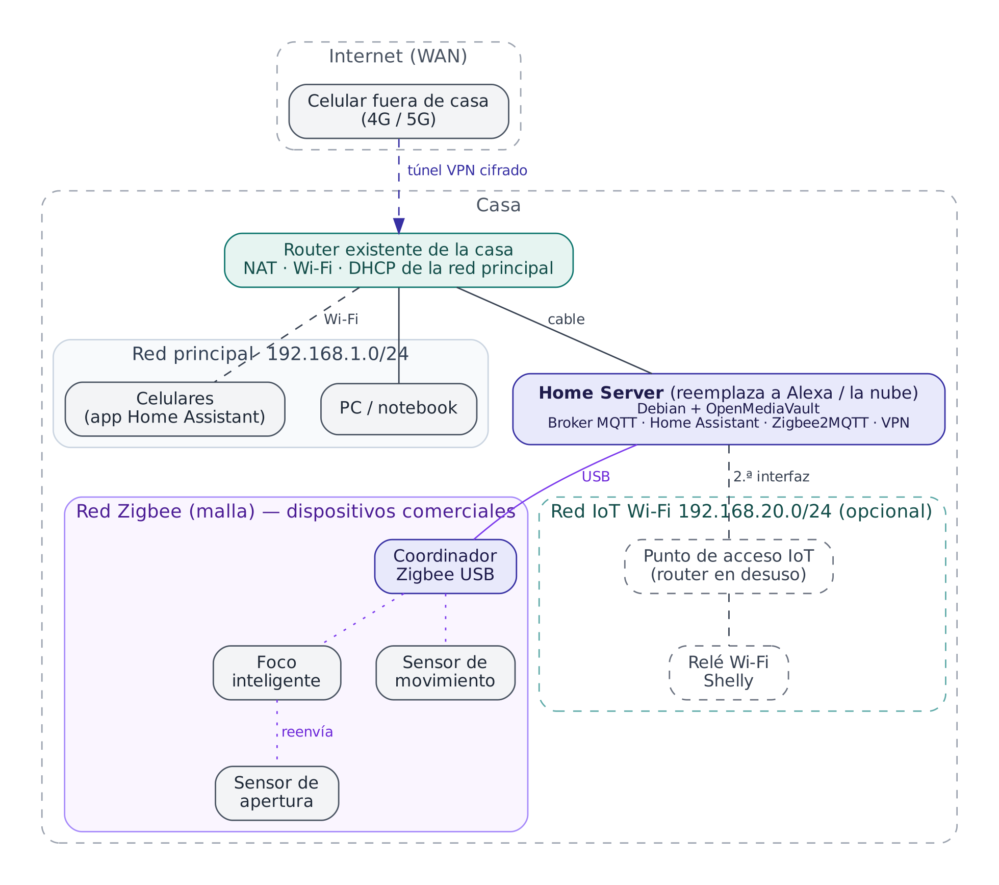

*Figura 1.1: Arquitectura general de la Smart Home propuesta. Fuente: elaboración propia.*

---

# 2. INFRAESTRUCTURA DE LA RED LOCAL DOMÉSTICA (LAN)

Para soportar el intercambio constante de mediciones y comandos en una Smart Home es indispensable contar con una red de área local (LAN) robusta. Esta red privada opera en un área geográfica reducida e interconecta los dispositivos IoT, los equipos de los usuarios y el servidor doméstico. A diferencia de las redes de área amplia (WAN), la LAN doméstica ofrece velocidades altas y retardos mínimos, y es la base sobre la que operan los protocolos de capas superiores como TCP y MQTT.

## 2.1. Topología y dispositivos de red

Las redes domésticas modernas usan mayoritariamente una topología en **estrella** o **estrella extendida**, en la que todos los nodos se comunican a través de equipos de interconexión centrales. Los componentes que estructuran esta topología son:

- **Router (enrutador).** Es el router que ya tiene la vivienda, sin requisitos especiales. Es el dispositivo de frontera que conecta la red doméstica con Internet a través del proveedor (ISP). Opera en la capa de red (capa 3): decide si un paquete es local o debe salir hacia Internet, y en ese caso lo envía por su ruta por defecto hacia el proveedor. También implementa NAT (ver 2.2).
- **Switch (conmutador).** Opera en la capa de enlace (capa 2) y concentra los dispositivos cableados mediante Ethernet (IEEE 802.3). Los routers domésticos ya integran un pequeño switch con varios puertos LAN, al que se conecta el Home Server por cable, para tener un enlace estable, sin interferencias y con ancho de banda dedicado. Un switch externo solo hace falta si no quedan puertos libres.
- **Punto de acceso (AP).** Como la mayoría de los nodos IoT (lámparas, sensores, relés) no tienen conexión cableada, el AP es fundamental: hace de puente entre el medio inalámbrico Wi-Fi (IEEE 802.11) y la red cableada. En la arquitectura propuesta, el AP principal es el que integra el router. Si se usan dispositivos IoT Wi-Fi, se agrega uno exclusivo para ellos, conectado directamente al Home Server.
- **Dispositivos finales (hosts).** Son los equipos ubicados en el extremo de la red que generan o consumen información: celulares, computadoras, sensores y actuadores. En MQTT asumen el rol de publicadores (*publishers*) y suscriptores (*subscribers*).

La casa queda organizada en hasta **tres redes**:

- la **red principal**, administrada por el router, donde están los celulares, las computadoras y el Home Server;
- la **red Zigbee**, que no usa IP y conecta los dispositivos comerciales (lámparas y sensores) con el coordinador USB del Home Server (sección 3.1);
- opcionalmente, la **red IoT Wi-Fi**, que cuelga de una segunda interfaz de red del Home Server y aloja los dispositivos Wi-Fi.

El motivo de esta separación se desarrolla en la sección 6.3.

Los dispositivos de la Smart Home pueden agruparse en tres tipos según su función (Figura 2.1):

- la **infraestructura de red**, que transporta los datos;
- el **núcleo**, que los procesa;
- los **dispositivos finales**, que los generan o los consumen como clientes MQTT.

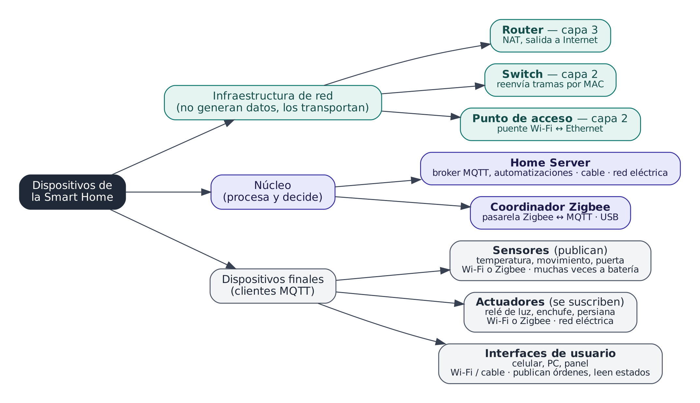

*Figura 2.1: Clasificación de los dispositivos de la Smart Home según su función. Fuente: elaboración propia.*

| Tipo | Ejemplos | Conectividad | Alimentación | Rol en MQTT |
|---|---|---|---|---|
| Sensor | Movimiento, apertura de puertas, temperatura, humo, agua | Zigbee (o Wi-Fi) | Batería | Publica |
| Actuador | Lámpara, enchufe, llave de luz, persiana | Zigbee o Wi-Fi | Red eléctrica | Se suscribe y publica su estado |
| Interfaz de usuario | Celular, PC | Wi-Fi o cable | Batería o red eléctrica | Envía órdenes y lee estados |
| Núcleo | Home Server, coordinador Zigbee | Cable y USB | Red eléctrica | Broker y pasarela |
| Infraestructura | Router, AP (y switch, si hace falta) | Cable y Wi-Fi | Red eléctrica | No participa: transporta |

*Tabla 2.1: Tipos de dispositivos de la Smart Home.*

## 2.2. Direccionamiento y encaminamiento

Para que el broker, los celulares y los sensores puedan comunicarse, cada equipo debe estar identificado lógicamente en la capa de red (dirección IP) y físicamente en la capa de enlace (dirección MAC).

**IP pública e IP privada.** Las redes domésticas usan bloques de direcciones IP privadas (RFC 1918), que solo tienen validez dentro de la casa y no se encaminan en Internet. Para que los dispositivos puedan comunicarse con el exterior, el router implementa **NAT** (*Network Address Translation*): traduce las múltiples direcciones privadas internas a la única IP pública que asigna el proveedor. Todo el tráfico entre los sensores y el broker usa exclusivamente direcciones privadas. Por eso la casa inteligente puede seguir funcionando aunque se corte la conexión a Internet (sección 3.3).

En la arquitectura propuesta se usan dos rangos privados:

- **Red principal (192.168.1.0/24):** la administra el router. El Home Server tiene en ella la dirección 192.168.1.10.
- **Red IoT Wi-Fi (192.168.20.0/24), opcional:** la administra el Home Server, que tiene la dirección 192.168.20.1.

Los dispositivos Zigbee no reciben dirección IP: se identifican dentro de su propia red, y el Home Server los representa en el broker (sección 3.1).

**Asignación de direcciones: DHCP y direcciones fijas.** Las direcciones se asignan habitualmente mediante **DHCP** (*Dynamic Host Configuration Protocol*), que automatiza la entrega de la IP, la máscara de subred y la puerta de enlace. Cada dirección se presta por un tiempo determinado. Esto es adecuado para dispositivos que se conectan y desconectan con frecuencia, como los celulares.

Para la infraestructura crítica, en cambio, el direccionamiento dinámico es un problema. Si el Home Server cambiara de IP tras un reinicio, todos los sensores perderían la conexión con el broker. Por eso:

- el servidor y los nodos IoT importantes reciben siempre la misma dirección, mediante una **reserva DHCP** basada en su dirección MAC;
- en la red principal, el servidor DHCP es el router;
- en la red IoT Wi-Fi, es el propio Home Server.

**Resolución ARP.** Aunque las aplicaciones identifican los destinos por su dirección IP, la entrega real de los datos dentro de la LAN requiere la dirección MAC de la placa de red de destino. La traducción entre ambas la realiza **ARP** (*Address Resolution Protocol*). Cuando el Home Server necesita enviar una orden a un relé inteligente Wi-Fi cuya IP conoce, el proceso es el siguiente (Figura 2.2):

1. El servidor verifica que la IP de destino pertenece a su misma subred.
2. Si no tiene la MAC del relé en su memoria caché, envía una solicitud ARP por **difusión** (*broadcast*) a toda la red.
3. Todos los equipos reciben la solicitud, pero solo el relé reconoce su IP y responde con su dirección MAC.
4. El servidor guarda la asociación IP–MAC y encapsula el paquete en una trama dirigida a esa MAC.
5. Los switches y puntos de acceso leen la MAC de destino, consultan su tabla de reenvío y envían la trama solo por el puerto o la interfaz inalámbrica donde está el relé.

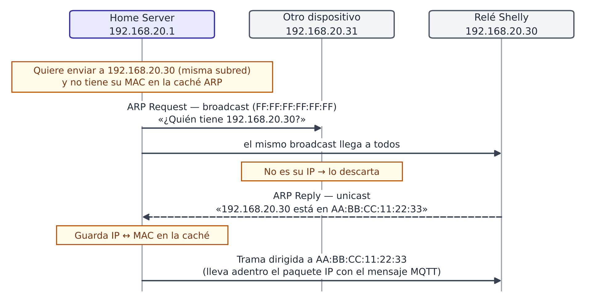

*Figura 2.2: Resolución de la dirección MAC del relé mediante ARP. Fuente: elaboración propia.*

---

# 3. HOME SERVER COMO NÚCLEO DE LA CASA INTELIGENTE

En los últimos años, las redes de computadoras pasaron de pensarse sobre todo para la comunicación entre personas a tener que conectar millones de dispositivos embebidos. Este fenómeno se conoce como Internet de las Cosas. Cuando los dispositivos intercambian información entre sí sin intervención humana, se habla de comunicación máquina a máquina (M2M). En una casa, esto se traduce en luces, sensores, cerraduras, cámaras y termostatos que necesitan coordinarse.

Hay dos maneras de resolver esa coordinación:

- **Enviar la información a servidores del fabricante en Internet.** Es lo que hacen casi todos los productos comerciales.
- **Instalar una computadora dentro de la LAN** que se encargue del procesamiento, el control, el monitoreo y la interconexión de todo. Esa computadora es el Home Server, y el enfoque se llama *Edge Computing*, o computación en el borde, porque el procesamiento se hace cerca de donde se generan los datos.

## 3.1. Rol y funciones del Home Server

En la arquitectura TCP/IP hay un principio de diseño según el cual las funciones complejas (el procesamiento, el manejo del estado y el significado de los datos de aplicación) deben ubicarse en los sistemas finales y no en el núcleo de la red. La red solo se ocupa de hacer llegar los paquetes; los extremos son los que entienden qué se está diciendo.

El Home Server es un ejemplo de esta idea: es un sistema final con bastante capacidad que concentra la lógica de control de la casa. Esto responde a una limitación concreta. Los sensores y microcontroladores tienen muy poca memoria y capacidad de cómputo, por lo que no pueden guardar una base de datos ni evaluar reglas complejas. El servidor, en cambio, puede:

- ejecutar varios procesos al mismo tiempo;
- mantener bases de datos persistentes;
- manejar varias interfaces de red a la vez.

Desde el modelo cliente-servidor, el Home Server corre procesos de servicio que permanecen escuchando en puertos determinados de la capa de transporte, a la espera de que algún cliente se comunique con ellos.

**El Home Server como intermediario (*middleware*).** En términos de software, el Home Server hace de intermediario entre dos niveles:

- abajo, el hardware físico: sensores, actuadores y microcontroladores;
- arriba, las interfaces de usuario y el motor de reglas.

Su función principal es abstraer los protocolos. En una casa real conviven dispositivos que usan Zigbee, Bluetooth Low Energy o Wi-Fi, y cada uno habla un idioma distinto. El servidor traduce todo a un formato común (en este trabajo, mensajes MQTT), para que el motor de automatizaciones funcione sin importar el fabricante o la tecnología de cada dispositivo.

**Bus de eventos y máquina de estados.** Plataformas como Home Assistant organizan su núcleo alrededor de un bus de eventos y una máquina de estados (Home Assistant, s.f.). El funcionamiento es así:

1. Un sensor detecta un cambio, por ejemplo una variación de temperatura o la apertura de un contacto magnético.
2. El sistema genera un evento en el bus y actualiza el estado de esa entidad.
3. Los módulos del servidor están suscritos al bus: reaccionan en el momento, evalúan las condiciones y ejecutan las acciones que correspondan.

La ventaja de este diseño es el **desacoplamiento**: quien detecta el cambio no necesita saber quién va a reaccionar, y quien reacciona no necesita saber quién lo originó. Por eso se pueden agregar automatizaciones nuevas sin modificar las existentes. Es la misma idea que el modelo publicación/suscripción de MQTT (sección 4.1).

**Redes de sensores de baja potencia.** Muchos sensores a batería no usan Wi-Fi, sino el estándar IEEE 802.15.4, pensado para enlaces de bajo consumo con tramas de hasta 127 bytes. **Zigbee** funciona sobre este estándar con su propia pila de protocolos, que no es IP. Por eso necesita una pasarela para comunicarse con el resto de la red. En los productos comerciales, ese papel lo cumple el *hub* de la marca o el asistente (algunos modelos de Alexa traen uno integrado). En este trabajo lo cumple un **coordinador** USB conectado al Home Server, junto con un programa que traduce los mensajes Zigbee a MQTT. Así, una lámpara o un sensor comercial Zigbee de cualquier marca puede integrarse sin depender de la nube del fabricante. Otras tecnologías, como **Thread**, sí transportan IPv6 sobre 802.15.4 mediante la capa de adaptación 6LoWPAN (RFC 4944).

**Resolución de nombres.** Para que los dispositivos Wi-Fi encuentren al broker por nombre y no dependan de su dirección IP, el Home Server ofrece un servicio de **DNS** en la red IoT (por ejemplo, `broker.casa` → 192.168.20.1). Otra alternativa habitual en redes domésticas es **mDNS** (DNS multicast, RFC 6762), que resuelve nombres sin un servidor: la consulta se envía por *multicast* a toda la red local (224.0.0.251, puerto UDP 5353) y responde el equipo que tiene ese nombre. Como el multicast no sale de su propia red, mDNS no sirve para comunicar la red IoT con la principal.

**Software del Home Server.** La Figura 3.1 muestra cómo se organiza el servidor propuesto:

- Sobre el sistema operativo **Debian** corre **OpenMediaVault**, que permite administrar el equipo desde el navegador.
- Cada servicio de la casa corre en su propio contenedor: el broker MQTT, la plataforma de automatizaciones, la pasarela Zigbee y la VPN.

El detalle de cada programa se presenta en la sección 7.3.

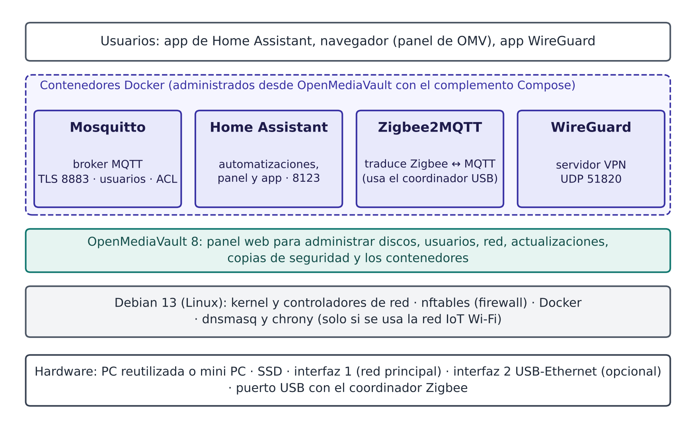

*Figura 3.1: Organización del software del Home Server. Fuente: elaboración propia.*

## 3.2. Topología local (Edge Computing) frente a topología Cloud

Al diseñar la red de una casa inteligente hay que decidir si el procesamiento se hace de forma local o en la nube (Figura 3.2):

- **Topología Cloud**, la de los sistemas comerciales. Los dispositivos actúan casi como terminales sin lógica propia: envían los datos a servidores remotos (AWS, Google Cloud o la infraestructura del fabricante), allí se procesan las reglas y la orden vuelve a la vivienda.
- **Topología local.** El Home Server propone lo contrario: el procesamiento se hace dentro de la casa.

Para compararlas se analizan cuatro aspectos: los componentes del retardo, las colas y el *bufferbloat*, el *jitter*, y la privacidad y la dependencia del fabricante.

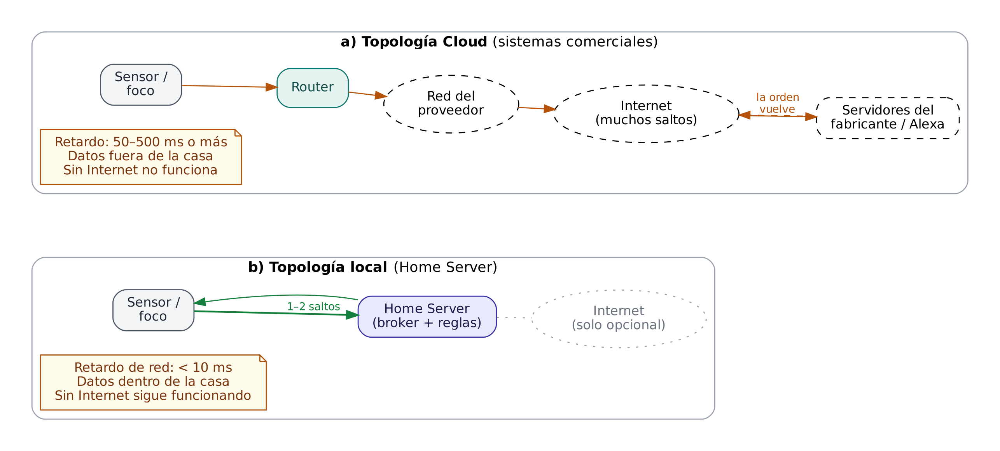

*Figura 3.2: Topología Cloud frente a topología local. Fuente: elaboración propia.*

**Componentes del retardo.** Cada vez que un paquete atraviesa un nodo (un router, un switch o el propio servidor), sufre un **retardo nodal** compuesto por cuatro términos (Kurose y Ross, 2017):

$$d_{nodal} = d_{proc} + d_{cola} + d_{trans} + d_{prop}$$

- $d_{proc}$ es el **retardo de procesamiento**: el tiempo que tarda el nodo en examinar la cabecera y decidir a dónde enviar el paquete.
- $d_{cola}$ es el **retardo de cola**: el tiempo que el paquete espera en el buffer antes de ser transmitido.
- $d_{trans} = L/R$ es el **retardo de transmisión**, donde $L$ es la longitud del paquete en bits y $R$ la velocidad del enlace en bits por segundo.
- $d_{prop} = d/v$ es el **retardo de propagación**, donde $d$ es la longitud del enlace y $v$ la velocidad de propagación de la señal en el medio, cercana a $2 \times 10^8$ m/s.

El retardo total que sufre un paquete es la **suma de los retardos nodales de todos los saltos del camino**. Esa es la diferencia central entre las dos topologías:

- en la red local, el camino tiene uno o dos saltos;
- hacia un servidor en la nube puede tener decenas.

En una topología local, el tráfico queda dentro de la LAN:

- las distancias son de decenas de metros, así que el retardo de propagación es una fracción de microsegundo;
- con enlaces de 1 Gbps, transmitir una trama de tamaño estándar lleva pocos microsegundos.

Por eso el tiempo de ida y vuelta (RTT) dentro de una LAN suele estar entre 0,1 ms y 10 ms. En una acción como encender una luz a partir de un sensor de movimiento, el componente de red es menor a 10 ms, un tiempo que una persona no percibe.

En la topología Cloud, cada operación atraviesa la WAN hasta el centro de datos del proveedor:

- con la velocidad de propagación indicada, la señal tarda unos 5 ms por cada mil kilómetros solo por la propagación;
- a eso se suman los retardos de procesamiento y de cola de cada router intermedio, y las consultas DNS.

Los valores resultantes son variables. A modo orientativo, van de 50 a 500 ms o más.

**Teoría de colas y *bufferbloat*.** El componente que más afecta a la topología Cloud es el retardo de cola. Si se modela cada enlace como una cola M/M/1, el retardo medio en el nodo crece con la utilización del enlace ρ (con 0 ≤ ρ < 1) de forma proporcional a:

$$T \propto \frac{1}{1-\rho}$$

Con el enlace al 50 % de uso el factor vale 2, al 90 % vale 10 y al 99 % vale 100. Es decir, el retardo no empeora de a poco, sino que **se dispara** cuando el enlace se acerca a su capacidad (Figura 3.3). En la LAN la utilización es baja; en el enlace de subida del hogar o en la WAN, en cambio, puede acercarse a 1.

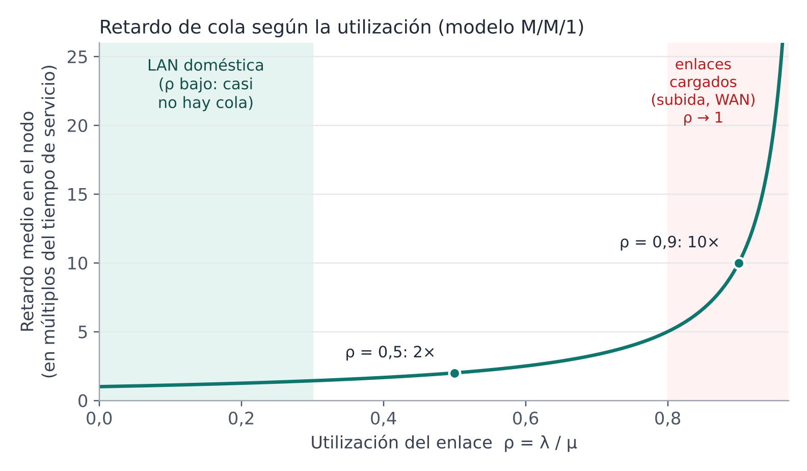

*Figura 3.3: Retardo medio en un nodo en función de la utilización del enlace (modelo M/M/1). Fuente: elaboración propia a partir de Kurose y Ross (2017).*

A esto se agrega el ***bufferbloat***. Los fabricantes aumentaron mucho la memoria de los routers y módems hogareños, que pueden acumular megabytes de paquetes antes de descartar alguno. El caso típico es el siguiente:

1. Un usuario descarga un archivo grande y satura el enlace con el proveedor.
2. En ese momento, un sensor intenta enviar un evento a la nube.
3. Su paquete queda al final de una cola muy larga en el router de acceso, con un retardo que puede superar el segundo.

Para un evento de control, como activar una alarma o accionar un interruptor, ese retardo no es aceptable. En la topología local esto no ocurre, porque el tráfico de control no compite con el del enlace a Internet.

***Jitter*.** El *jitter* es la variación del retardo entre un paquete y otro. En las comunicaciones en tiempo real sobre IP, esa variación obliga a los receptores a usar buffers de reproducción para ordenar los paquetes, lo que agrega más retardo. En una LAN conmutada, sin la congestión de la WAN, el *jitter* es muy bajo, de modo que las automatizaciones responden de manera consistente.

**Privacidad y soberanía de los datos.** Una casa inteligente genera datos sensibles: cuándo hay gente, a qué hora se duermen sus habitantes, cuánta energía se consume, qué ven las cámaras. Juntos permiten reconstruir la rutina de una familia.

- **En el modelo Cloud,** esos datos viajan por la red pública y se guardan en servidores de terceros. Quedan expuestos a interceptaciones, a fallas de seguridad del proveedor o a cambios en sus políticas de privacidad.
- **Con el Home Server,** las mediciones, el estado de los sensores y las imágenes quedan dentro de la vivienda, en discos de la propia casa. Esto es coherente con el principio de privacidad desde el diseño.

**Dependencia del fabricante.** Cuando el sistema depende de la nube del fabricante, también depende de que esa empresa siga funcionando. Si cambia su interfaz de programación, cobra por funciones que antes eran gratuitas o cierra sus servidores, los dispositivos quedan inutilizables aunque el hardware funcione, y terminan como residuo electrónico. El Home Server reduce este riesgo porque integra los dispositivos de forma local y con protocolos abiertos. Por eso conviene elegir dispositivos basados en estándares, como Zigbee, que funcionan con cualquier coordinador compatible y no solo con el de su marca.

| Aspecto | Topología local (Home Server) | Topología Cloud |
|---|---|---|
| Retardo de la acción | Menor a 10 ms (componente de red) | 50 a 500 ms o más |
| *Jitter* | Muy bajo | Variable, depende de la WAN |
| Efecto de la congestión del enlace a Internet | Ninguno | Alto (*bufferbloat*) |
| Ubicación de los datos | Dentro de la casa | Servidores de terceros |
| Dependencia del fabricante | Baja | Alta |
| Si se corta Internet | La casa sigue funcionando | La casa deja de responder |

*Tabla 3.1: Comparación entre la topología local y la topología Cloud.*

## 3.3. Tolerancia a fallos, modo offline y resiliencia en la LAN

El protocolo IP ofrece un servicio de datagramas sin conexión, no confiable y de **mejor esfuerzo** (*best-effort*): no garantiza que los paquetes lleguen. En la WAN, los paquetes pueden perderse o demorarse por congestión o por fallas en los enlaces del proveedor. Por eso la caída de Internet debe tratarse como algo que va a pasar en algún momento, y que no debería dejar sin funcionar a la casa.

El Home Server lo logra aplicando el principio de **degradación elegante** (*graceful degradation*):

- durante un corte se pierden las funciones secundarias que dependen del exterior, como el pronóstico del tiempo, la síntesis de voz en la nube o las notificaciones al celular fuera de casa;
- los subsistemas de control y de seguridad siguen funcionando.

Esto se explica por lo que ocurre en las capas inferiores (Figura 3.4).

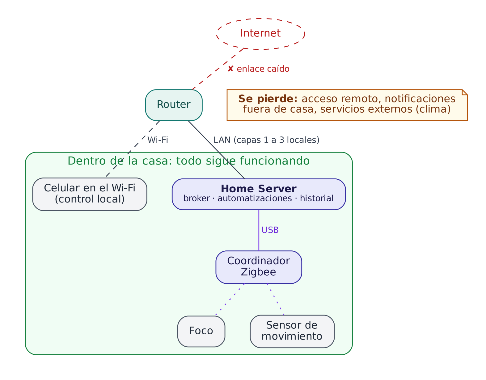

*Figura 3.4: Funcionamiento de la casa ante un corte de Internet. Fuente: elaboración propia.*

**Capa de enlace.** Los switches y puntos de acceso de la LAN no dependen de Internet. Los switches arman su tabla de reenvío con un algoritmo de aprendizaje: miran la dirección MAC de origen de cada trama y la asocian al puerto por el que llegó. Con esa tabla siguen conmutando tramas entre los dispositivos locales.

**Capa de red.** Los equipos de cada red comparten el mismo prefijo de subred, por lo que se comunican entre sí sin pasar por una puerta de enlace hacia Internet. El servidor DHCP sigue entregando direcciones. La resolución ARP (sección 2.2) tampoco depende de la WAN, porque usa mensajes de difusión dentro de la propia red. En IPv6, la función equivalente la cumple el protocolo de descubrimiento de vecinos (NDP).

**Redes de malla autónomas.** La red Zigbee forma una red de área personal inalámbrica (WPAN) en malla, que no depende del router Wi-Fi ni de la infraestructura IP de la casa: se comunica directamente con el coordinador USB del Home Server. Un corte de la red externa no la afecta.

**Los dispositivos no dependen del router.** En la arquitectura propuesta, los dispositivos Zigbee se conectan al Home Server a través del coordinador USB, y los dispositivos Wi-Fi opcionales, a través de su segunda interfaz. Por eso, incluso si se cae el router, la lámpara, los sensores y el relé Wi-Fi siguen comunicándose con el broker, y las automatizaciones siguen corriendo. Solo se pierde el control desde el celular, que depende del Wi-Fi del router.

**Lógica de control local.** El Home Server guarda en su memoria la lógica de control, los perfiles de usuario y el estado actualizado de los dispositivos. No necesita consultar un servicio externo cada vez que se dispara una regla. Cuando se activa un sensor de movimiento:

1. El mensaje viaja por la LAN hasta el Home Server.
2. El motor de automatizaciones evalúa la regla que ya tiene en memoria.
3. El servidor envía la orden al actuador.

Ningún paquete de este lazo de control sale por la interfaz WAN del router.

**Qué se pierde y qué se conserva.** Durante un corte de Internet:

- **se pierden** las funciones que dependen del exterior: el clima, las notificaciones remotas, la voz en la nube y el acceso desde fuera de casa;
- **se conservan** las que importan para el uso diario y la seguridad: la iluminación, la climatización, las alarmas y el control de accesos.

El sistema trabaja en modo offline, de forma aislada y autocontenida.

---

# 4. PROTOCOLOS DE COMUNICACIÓN IoT

## 4.1. Protocolo MQTT y modelo de publicación/suscripción

MQTT es un protocolo de capa de aplicación diseñado para intercambiar mensajes entre dispositivos de manera simple y con un consumo reducido de recursos. Está estandarizado por OASIS (*Organization for the Advancement of Structured Information Standards*). La especificación lo define como un protocolo de mensajería cliente-servidor basado en publicación/suscripción, especialmente útil cuando el ancho de banda o los recursos de los dispositivos son limitados (OASIS, 2019). Su nombre proviene históricamente de *MQ Telemetry Transport*, desarrollado en IBM, pero en el estándar actual "MQTT" es simplemente el nombre del protocolo.

MQTT tiene dos características principales:

- **Es liviano.** Su encabezado fijo mínimo ocupa solo 2 bytes, por lo que agrega poco *overhead* cuando los mensajes son chicos. Además, funciona sobre TCP, que entrega los bytes en orden y sin pérdidas.
- **Desacopla a los dispositivos.** El publicador no necesita conocer al suscriptor: ambos se comunican solo con el broker. Esto facilita agregar o quitar dispositivos sin rediseñar la comunicación.

**Del modelo cliente-servidor al de publicación/suscripción.** En el modelo cliente-servidor tradicional:

- el **cliente** inicia una solicitud;
- el **servidor** permanece disponible para recibirla, procesarla y devolver una respuesta;
- el servidor se identifica con una dirección IP y un puerto.

Este modelo centraliza el servicio, lo que facilita la administración, pero genera dependencia del servidor. MQTT introduce una variante importante: aunque los clientes se conectan a un servidor (el **broker**), la comunicación entre aplicaciones se organiza mediante publicación y suscripción, y los dispositivos no se comunican directamente entre sí.

**Modelo de publicación/suscripción.** En esta arquitectura, los mensajes se envían a un intermediario que los recibe, los organiza y los distribuye entre los interesados (Figura 4.1). Hay tres elementos:

- **Publicador (*publisher*):** el cliente que genera y publica la información. No necesita saber qué equipos la recibirán ni sus direcciones IP: solo la envía al broker, indicando el *topic* (tema) al que pertenece.
- **Suscriptor (*subscriber*):** el cliente interesado en recibir determinada información. Se suscribe a uno o varios topics, y cuando se publica un mensaje en alguno de ellos, el broker se lo entrega automáticamente.
- **Broker:** ocupa el papel central. Recibe los mensajes de los publicadores, identifica su topic y los distribuye a todos los suscriptores de ese topic.

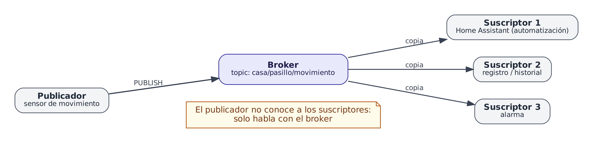

*Figura 4.1: Modelo de publicación/suscripción. Fuente: elaboración propia.*

Por ejemplo, un sensor de temperatura publica periódicamente sus mediciones en el topic `casa/cocina/temperatura`. El sensor no necesita saber qué dispositivos van a usar ese dato; una automatización o la aplicación del celular pueden estar suscritas y recibirlo.

Lo mismo vale para los actuadores. Se publica la orden `ON` en el topic `casa/cocina/luz`, y la lámpara suscrita a ese topic la recibe y enciende la luz.

Además:

- un mismo cliente puede ser publicador y suscriptor a la vez: la lámpara recibe órdenes en un topic y publica su estado en otro;
- si varios clientes están suscritos al mismo topic, todos reciben el mensaje, lo que permite sumar dispositivos sin modificar al publicador.

**Broker.** El broker acepta conexiones TCP de todos los clientes (sensores, actuadores, aplicaciones) y los identifica mediante un identificador de cliente (*Client ID*). Para cada cliente puede mantener una **sesión**, en la que guarda sus suscripciones y los mensajes pendientes de confirmación. La Figura 4.2 muestra los clientes del broker en la casa propuesta: Home Assistant, Zigbee2MQTT (que representa a los dispositivos Zigbee) y los dispositivos Wi-Fi, cada uno asociado a sus topics. El intercambio de mensajes entre los clientes y el broker se detalla en la sección 4.3.

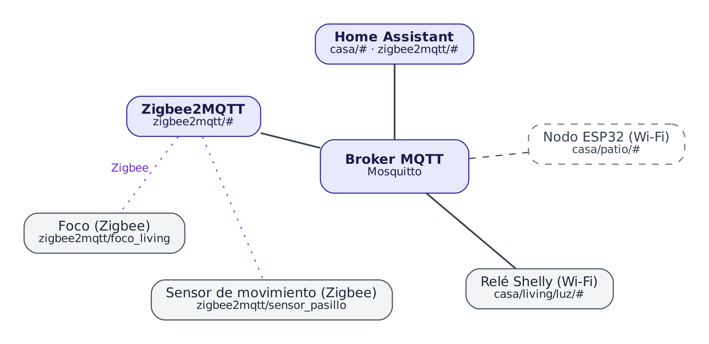

*Figura 4.2: Clientes del broker en la Smart Home propuesta y sus topics. Fuente: elaboración propia.*

**Topics.** Un topic es una cadena de texto que identifica y organiza los mensajes que circulan por el broker. Se organiza de forma jerárquica con el carácter `/` como separador, como las carpetas de una computadora (Figura 4.3). Por ejemplo:

- `casa/cocina/temperatura` puede usarse para publicar la temperatura de la cocina;
- `casa/cocina/luz` puede usarse para las órdenes o el estado de la iluminación de ese ambiente.

Al suscribirse, un cliente puede indicar un topic exacto o usar **comodines**:

- `+` reemplaza un solo nivel: `casa/+/luz` recibe las luces de todos los ambientes;
- `#` reemplaza todos los niveles que siguen: `casa/cocina/#` recibe todo lo de la cocina.

El árbol completo de topics usado en este trabajo se presenta en el Anexo B.

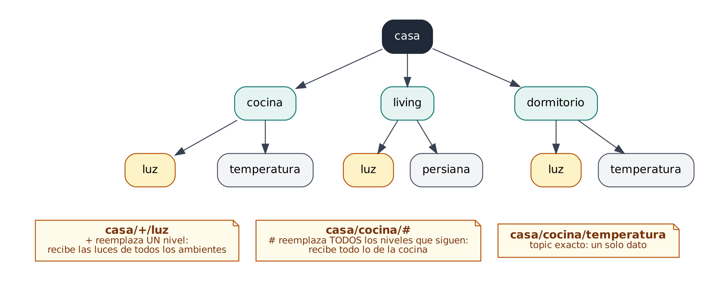

*Figura 4.3: Organización jerárquica de los topics y uso de los comodines + y #. Fuente: elaboración propia.*

## 4.2. Comparación entre MQTT y HTTP en aplicaciones IoT

**Características generales.** HTTP (*Hypertext Transfer Protocol*) es el protocolo base de la web y puede usarse en cualquier aplicación cliente-servidor. Está orientado a transacciones: el cliente (generalmente un navegador) hace una solicitud y el servidor devuelve una respuesta. Ambos protocolos son de capa de aplicación y funcionan sobre TCP, pero se comunican de forma distinta:

- **en HTTP,** el cliente siempre inicia el intercambio, y cada pedido es independiente (el protocolo no guarda estado);
- **en MQTT,** los dispositivos mantienen una conexión abierta con el broker y reciben los mensajes de los topics a los que se suscribieron.

**Publicación/suscripción frente a petición/respuesta.** En el modelo petición/respuesta de HTTP:

1. El cliente abre una conexión TCP con el servidor.
2. Envía una solicitud con un método, una URL y los parámetros.
3. El servidor la procesa y devuelve una respuesta con un código de estado y, si corresponde, un contenido.

El servidor nunca habla primero: solo responde cuando se le pregunta. En el modelo de MQTT, en cambio, quien tiene un dato lo publica y quienes lo quieren se suscriben una sola vez. Cuando llega un mensaje, el broker lo reenvía a todos los suscriptores sin que tengan que preguntar.

La diferencia se ve en un ejemplo. Para saber si una lámpara está encendida usando petición/respuesta, hay que preguntarlo, y para enterarse de un cambio hay que seguir preguntando cada tanto (*polling*). Con publicación/suscripción, la lámpara publica su estado cuando cambia y el celular, que ya está suscrito, se entera en el momento (Figura 4.4).

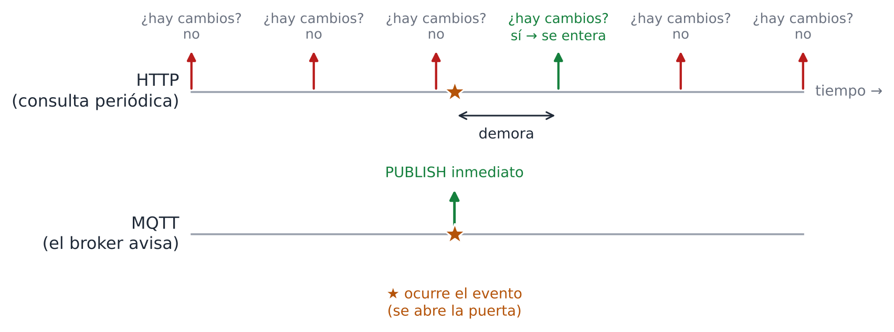

*Figura 4.4: Con HTTP el cliente debe consultar periódicamente; con MQTT el broker avisa en el momento. Fuente: elaboración propia.*

**Conexiones persistentes y REST.** En su forma más simple, HTTP abre una conexión TCP nueva para cada transacción y la cierra al terminar. Como cada conexión implica el saludo en tres pasos de TCP, esto es poco eficiente. Para evitarlo existen las **conexiones persistentes**: una misma conexión se mantiene abierta y se reutiliza para varias solicitudes (en HTTP/1.1 es el comportamiento por defecto).

Sin embargo, la conexión abierta no cambia el modelo: HTTP sigue siendo de petición/respuesta y sin estado, y el servidor solo habla cuando el cliente le pregunta. En MQTT, en cambio, la conexión abierta tiene otro propósito: permite que el broker le envíe mensajes al dispositivo en cualquier momento.

Para organizar la comunicación sobre HTTP se usa mucho **REST**, que no es un protocolo sino un estilo de arquitectura (Fielding, 2000). Cada elemento que se quiere manejar es un recurso identificado por una URL, sobre el que se opera con los métodos de HTTP. Por ejemplo:

- un `GET` a la URL de la lámpara del living consulta su estado;
- un `PUT` con el contenido `ON` la enciende.

Para enterarse de un cambio, el cliente tiene que volver a preguntar.

**Overhead.** Se llama *overhead* a los bytes que un protocolo agrega para funcionar (cabeceras y confirmaciones) y que no son el dato útil. En IoT es importante porque los mensajes son muy chicos: un `ON` para una lámpara ocupa solo 2 bytes.

Como ambos protocolos viajan sobre TCP/IP, pagan el mismo costo de transporte: al menos 40 bytes de cabeceras TCP e IP por segmento. La diferencia está en la capa de aplicación:

- **HTTP** usa cabeceras de texto, cada solicitud lleva su respuesta y, en una implementación típica, abre una conexión por transacción;
- **MQTT** usa mensajes binarios con una cabecera fija de al menos 2 bytes, se conecta una sola vez y, con QoS 0, no espera respuesta.

Para encender una lámpara con el mensaje `ON`, una petición HTTP mínima con su respuesta ocupa unos 109 bytes de capa de aplicación, mientras que un PUBLISH de MQTT con QoS 0 ocupa 25 (Figura 4.5; el desglose está en el Anexo A). En la práctica, HTTP agrega más cabeceras y pesaría más.

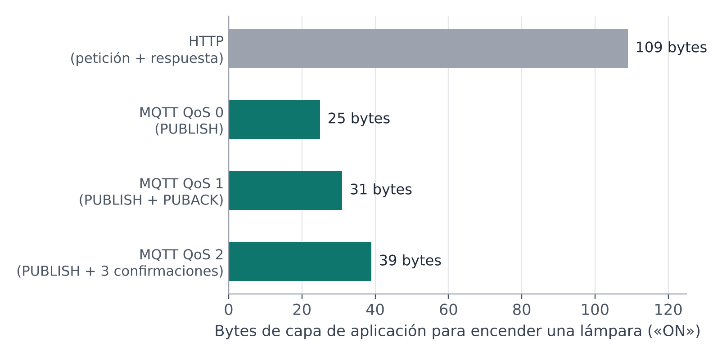

*Figura 4.5: Bytes de capa de aplicación necesarios para encender una lámpara. Fuente: elaboración propia (ver Anexo A).*

**Consumo de recursos y energía.** Un dispositivo IoT, como un sensor o un ESP32 a batería, tiene poca memoria, poco procesamiento y, sobre todo, poca energía. Cada vez que se comunica debe mantener activa la radio, y eso consume batería: cuanto menos tiempo se comunique, más tiempo puede quedarse en reposo. Es la misma idea que se aplica en las LAN inalámbricas con los modos de descanso (*sleep mode*).

- **HTTP:** en cada orden puede tener que abrir una conexión, enviar una petición con cabeceras de texto y esperar la respuesta.
- **MQTT:** envía mensajes más chicos, con QoS 0 no espera respuesta y reutiliza la conexión.

Como contrapartida, MQTT debe avisar cada tanto que sigue activo (mensajes PINGREQ, sección 4.3), lo que le impide estar en reposo profundo durante períodos muy largos. En un sensor que envía un dato por hora, la diferencia entre ambos protocolos puede ser mucho menor.

Un estudio que midió ambos protocolos en un dispositivo a batería para monitoreo de transporte refrigerado encontró que MQTT consumió un 6,03 % menos que HTTP con QoS 0 y un 8,33 % menos con QoS 1 (Camacho-León et al., 2023). Son ahorros reales pero moderados, y dependen del equipo y de las condiciones de la prueba. Por eso no deben presentarse como una regla general.

En esta Smart Home, los sensores a batería (temperatura, apertura de puertas) son los que más se benefician de MQTT. Un relé conectado a la red eléctrica no tiene problema de energía: en ese caso, MQTT se elige por el modelo de publicación/suscripción y el bajo overhead.

**Síntesis.** No hay un protocolo mejor en todos los casos. La Tabla 4.1 resume la comparación.

| Aspecto | MQTT | HTTP |
|---|---|---|
| Modelo | Publicación/suscripción | Petición/respuesta |
| Quién inicia la comunicación | El publicador; el broker entrega a los suscriptores | Siempre el cliente |
| Cómo se entera el interesado de un cambio | Recibe un aviso | Tiene que preguntar (*polling*) |
| Peso de los mensajes | Muy liviano (cabecera binaria) | Más pesado (cabeceras de texto) |
| Consumo en dispositivos a batería | Menor | Mayor |
| Comunicación de uno a muchos | Natural | Poco práctica: una petición por destinatario |
| Garantía de entrega configurable | Sí (QoS) | No |
| Seguridad | Hay que agregar TLS y autenticación | Hay que agregar TLS (HTTPS) y autenticación |
| Facilidad de uso y soporte | Requiere instalar un broker | Universal: lo entiende cualquier navegador |
| Punto único de falla | El broker | El servidor |

*Tabla 4.1: Comparación entre MQTT y HTTP.*

MQTT encaja mejor para la comunicación entre sensores, actuadores y el Home Server, porque los mensajes son chicos, frecuentes y muchas veces de uno a muchos. HTTP sigue siendo útil para otras tareas, como la interfaz web de configuración o la aplicación del usuario. En la práctica, los dos conviven (sección 5.2).

## 4.3. Funcionamiento interno y mensajes de MQTT

MQTT funciona mediante distintos tipos de mensajes de control, y cada uno cumple una función concreta. La Figura 4.6 resume el ciclo completo de una sesión.

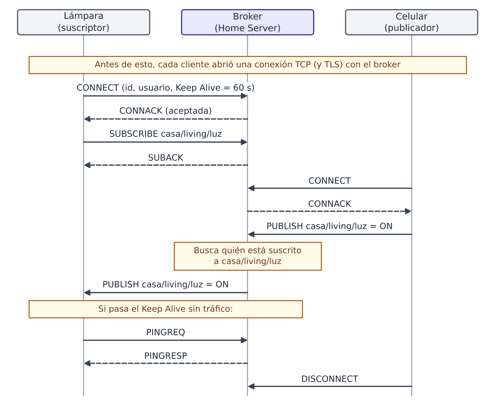

*Figura 4.6: Intercambio de paquetes MQTT entre dos clientes y el broker. Fuente: elaboración propia.*

**Establecimiento de la conexión.** Antes de publicar o recibir mensajes, el cliente debe abrir una conexión TCP con el broker (y, si se usa cifrado, establecer la sesión TLS de la sección 6.1). Recién entonces comienza la comunicación MQTT:

1. El cliente envía **CONNECT**, que significa "quiero iniciar una sesión MQTT con el broker". Dentro de ese mensaje incluye:
   - su *Client ID*;
   - datos de la sesión;
   - el tiempo de *Keep Alive*;
   - sus credenciales, si se usa autenticación;
   - opcionalmente, un mensaje de última voluntad (*Will Message*), que el broker publicará si el cliente se desconecta de forma inesperada.
2. El broker responde con **CONNACK** (*Connection Acknowledgment*), que indica si aceptó la conexión o si hubo un problema.

CONNECT no establece la conexión TCP: establece la sesión a nivel de MQTT sobre una conexión TCP que ya existe.

**Suscripción a topics.** Una vez conectado, el cliente informa qué información quiere recibir mediante **SUBSCRIBE**, que registra una o más suscripciones. Por ejemplo, una lámpara puede suscribirse a `casa/cocina/luz` para recibir las órdenes de encendido. Técnicamente, cada suscripción es un **filtro de topic** (*topic filter*), porque puede incluir comodines (sección 4.1).

El broker responde con **SUBACK** (*Subscribe Acknowledgment*), que confirma el resultado de cada suscripción. A partir de ese momento, el cliente no necesita consultar al broker: cuando otro cliente publica en un topic que coincide con su suscripción, el broker se lo entrega automáticamente.

**Publicación.** Cualquier cliente conectado puede enviar información mediante **PUBLISH**, el mensaje que transporta los datos de la aplicación. Debe indicar:

- el **topic**, que el broker usa para saber a quién entregar el mensaje;
- el **contenido**, o carga útil (*payload*).

Por ejemplo, para abrir una persiana se publica `ABRIR` en `casa/living/persiana`. El broker recibe el mensaje, analiza el topic y lo reenvía a los clientes suscritos.

El payload no tiene un formato obligatorio: puede contener texto, números, estructuras como JSON o datos binarios. MQTT solo lo transporta; su interpretación queda a cargo de la aplicación que lo recibe.

El PUBLISH también lleva información de control:

- el nivel de **QoS**, que establece la garantía de entrega (sección 4.4);
- la opción ***Retain***: si está activada, el broker conserva el último mensaje publicado en ese topic y lo entrega de inmediato a cualquier cliente que se suscriba más tarde. Es útil para los estados: quien se conecte sabrá enseguida si la luz está encendida.

**Mantenimiento de la conexión.** Un cliente puede permanecer conectado durante minutos sin necesidad de intercambiar información; por ejemplo, un sistema de riego que no tiene nada que informar. Para controlar que la conexión siga activa, MQTT usa el mecanismo de ***Keep Alive***:

- Es un intervalo, en segundos, que el cliente informa al conectarse. Indica cuánto tiempo puede pasar sin que envíe ningún paquete.
- Mientras el cliente envíe mensajes normalmente, no hace falta tráfico adicional.
- Si no tiene nada que enviar, al cumplirse el intervalo envía **PINGREQ**, y el broker responde con **PINGRESP**. Ambos son mensajes muy pequeños, sin payload.

El mecanismo también detecta conexiones caídas:

- si el broker no recibe ningún paquete del cliente durante una vez y media el intervalo de *Keep Alive*, el estándar establece que debe cerrar la conexión;
- de forma similar, si el cliente no recibe el PINGRESP en un tiempo razonable, puede considerar que el broker ya no está disponible.

Por ejemplo, con un *Keep Alive* de 60 segundos, un sensor que no tiene nada que publicar envía un PINGREQ antes de que pase ese tiempo. Si el sensor desaparece de la red, el broker lo detecta y cierra la conexión. Si se configura en cero, el mecanismo queda deshabilitado.

PINGREQ y PINGRESP no deben confundirse con el comando `ping`. El comando `ping` usa ICMP en la capa de red, mientras que estos son mensajes propios de MQTT, en la capa de aplicación.

## 4.4. Calidad de servicio (QoS) en MQTT

**Concepto.** En redes, no todas las aplicaciones necesitan lo mismo:

- algunas, como la voz y el video, son sensibles al retardo pero toleran perder algún dato;
- otras, como la transferencia de archivos, no toleran pérdidas pero sí demoras.

Se llama **calidad de servicio** (QoS, *Quality of Service*) a dar un trato distinto a cada tipo de tráfico según lo que necesita.

En MQTT el concepto es más concreto: la QoS no habla de velocidad ni de retardo, sino del **nivel de garantía de que un mensaje llegue a destino**. Hay tres niveles:

- **QoS 0:** como máximo una vez.
- **QoS 1:** al menos una vez.
- **QoS 2:** exactamente una vez.

No todos los mensajes valen lo mismo. Perder una lectura de temperatura no es grave, porque enseguida llega otra, pero un aviso de "puerta forzada" tiene que llegar. Cuanta más garantía se pide, más confirmaciones se intercambian, lo que suma overhead y consumo. La QoS es, entonces, un equilibrio entre confiabilidad y costo.

El nivel se define **para cada mensaje**, no para todo el sistema:

- quien publica indica la QoS en el PUBLISH;
- quien se suscribe indica en el SUBSCRIBE el máximo que acepta recibir.

**Dónde se pierden o duplican los mensajes.** Como MQTT funciona sobre TCP, mientras la conexión esté activa los paquetes no se pierden: TCP retransmite lo que haga falta (sección 5.1). Los problemas aparecen cuando **la conexión se corta**, por ejemplo porque se cae el Wi-Fi, se reinicia un equipo o un dispositivo se queda sin batería. Los niveles de QoS definen qué pasa con los mensajes en ese caso.

### QoS 0: como máximo una vez

El mensaje se envía una sola vez y sin confirmación (Figura 4.7a). Llega una vez o no llega, pero nunca se repite. Como no se espera respuesta, el mensaje ni siquiera lleva un identificador.

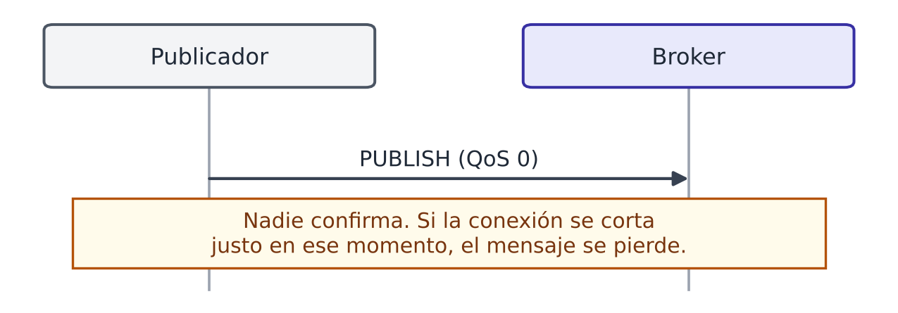

*Figura 4.7a: QoS 0. Fuente: elaboración propia.*

- **Ventajas:** es el más liviano (un solo mensaje de unos 25 bytes en el ejemplo del Anexo A), el más rápido y el que menos energía consume.
- **Limitaciones:** no hay garantía. Si la conexión se corta en ese momento o el broker se reinicia, el mensaje se pierde, y el emisor no se entera.
- **Cuándo conviene:** cuando perder un mensaje ocasional no es grave porque se envían datos seguidos. Stallings (2004) da un razonamiento similar para la recolección de datos de sensores: la pérdida ocasional de una unidad de datos no es grave, porque el siguiente informe llega en breve. Es el caso de un sensor de temperatura que publica cada pocos segundos. No sirve para algo que se envía una sola vez, como una alarma.

### QoS 1: al menos una vez

El receptor confirma cada mensaje con un **PUBACK** (Figura 4.7b). Cada PUBLISH lleva un identificador de paquete, y el PUBACK repite ese número para que el emisor sepa qué mensaje se confirmó. Mientras no llegue la confirmación, el emisor guarda una copia del mensaje.

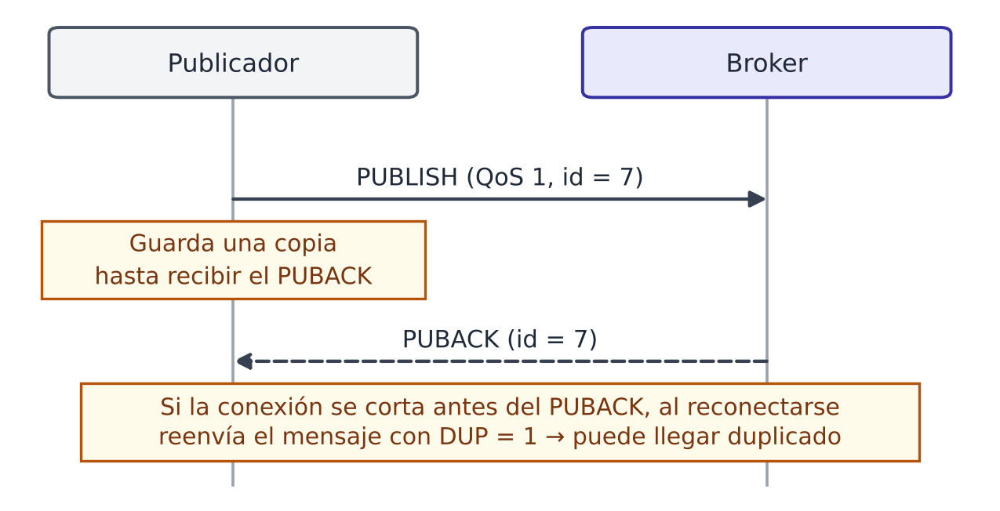

*Figura 4.7b: QoS 1. Fuente: elaboración propia.*

**¿Por qué puede llegar repetido?** Supongamos que el broker recibe el mensaje, pero la conexión se corta antes de que el PUBACK llegue al publicador. Entonces:

1. El publicador no sabe si el mensaje llegó.
2. Al reconectarse, lo reenvía marcado como duplicado (bandera DUP).
3. El broker puede terminar procesándolo dos veces.

Es el mismo problema que se estudia con las tramas y sus confirmaciones en la capa de enlace, aplicado a la conexión completa.

- **Ventajas:** garantiza que el mensaje llegue, y solo agrega un mensaje de control (27 + 4 = 31 bytes en el ejemplo, frente a 25 de QoS 0).
- **Limitaciones:** pueden llegar duplicados, por lo que la aplicación debe tolerarlos. Cuesta más tráfico, espera y consumo que QoS 0.
- **Cuándo conviene:** cuando el mensaje importa pero repetirlo no causa daño. "Encender la luz" repetido dos veces deja la luz encendida igual. En cambio, un comando del tipo "invertir el estado de la luz" fallaría si llega duplicado. Por eso, con QoS 1 conviene diseñar mensajes que puedan repetirse sin problema, como `ON` y `OFF` en lugar de "cambiar".

### QoS 2: exactamente una vez

El mensaje llega una sola vez, sin pérdidas ni duplicados. Para lograrlo, emisor y receptor intercambian cuatro mensajes en dos fases (Figura 4.7c):

1. **PUBLISH:** el emisor envía el mensaje.
2. **PUBREC:** el receptor confirma que lo recibió.
3. **PUBREL:** el emisor indica que puede liberarlo.
4. **PUBCOMP:** el receptor confirma que el intercambio terminó.

El receptor recuerda el identificador del mensaje hasta completar el intercambio. Si el mismo mensaje le llega repetido, lo reconoce y no lo procesa otra vez.

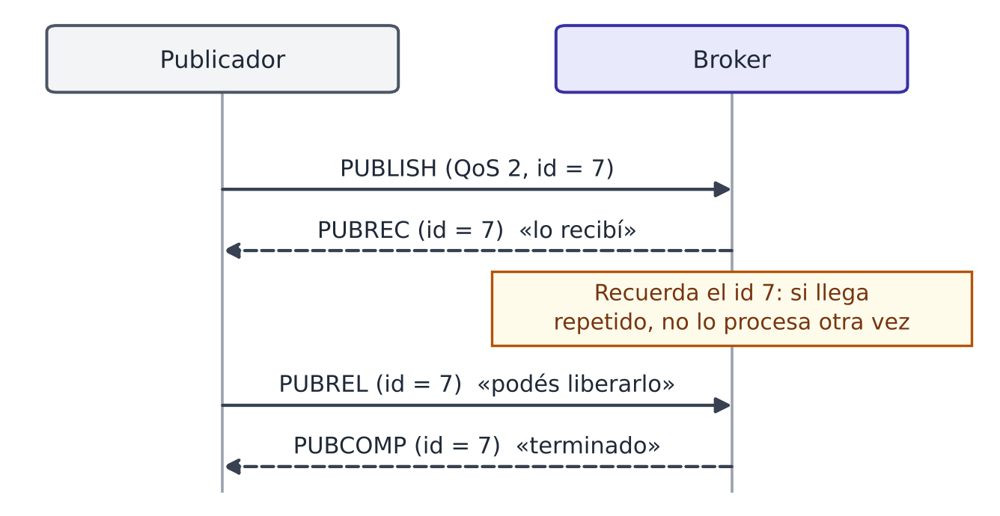

*Figura 4.7c: QoS 2. Fuente: elaboración propia.*

- **Ventajas:** la mayor garantía; la aplicación no necesita protegerse de duplicados.
- **Limitaciones:** es el más pesado (cuatro mensajes por dato) y el más lento. Además, gasta más energía y memoria, porque ambos extremos deben guardar el estado del mensaje hasta completar el intercambio.
- **Cuándo conviene:** cuando perder el mensaje o procesarlo dos veces es inaceptable y no se puede evitar de otra forma. Por ejemplo, un comando que suma algo cada vez que llega, como un contador de consumo. En la práctica, muchas veces alcanza con QoS 1 y mensajes repetibles.

### Comparación y selección del nivel

| | QoS 0 | QoS 1 | QoS 2 |
|---|---|---|---|
| Garantía | Como máximo una vez | Al menos una vez | Exactamente una vez |
| Mensajes del intercambio | 1 (PUBLISH) | 2 (PUBLISH, PUBACK) | 4 (PUBLISH, PUBREC, PUBREL, PUBCOMP) |
| ¿Se puede perder? | Sí | No | No |
| ¿Puede duplicarse? | No | Sí | No |
| Velocidad | Mayor | Media | Menor |
| Consumo de energía y memoria | Menor | Medio | Mayor |

*Tabla 4.2: Comparación de los niveles de QoS.*

No hay un nivel correcto para todo. Conviene elegir **el nivel más bajo que todavía cubra lo que necesita cada mensaje**, porque cada nivel más alto cuesta más tráfico, tiempo y energía. La Figura 4.8 muestra el criterio de decisión. Las respuestas dependen sobre todo de dos factores:

- **con qué frecuencia se renueva el dato:** si se actualiza seguido, perder uno importa poco;
- **qué tipo de mensaje es:** una lectura tolera más pérdidas que un comando.

También importa la energía disponible: en un dispositivo a batería conviene el nivel más bajo posible.

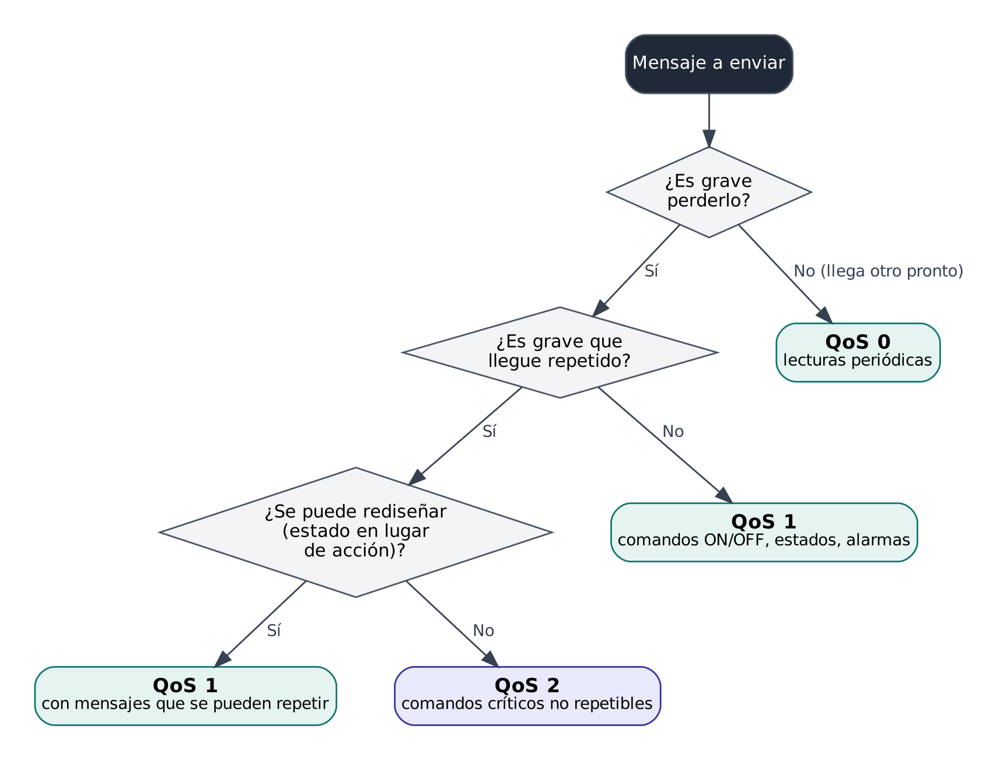

*Figura 4.8: Criterio para elegir el nivel de QoS de un mensaje. Fuente: elaboración propia.*

La Tabla 4.3 aplica este criterio a los dispositivos de la Smart Home.

| Dispositivo | Qué envía o recibe | Nivel sugerido | Observaciones |
|---|---|---|---|
| Sensores (temperatura, humedad, consumo) | Lecturas periódicas | QoS 0 | Si se pierde una, la siguiente la reemplaza, y se cuida la batería |
| Sensores de eventos (apertura de puerta) | Aviso puntual | QoS 1 | El evento no se repite solo, así que no puede perderse |
| Luces, enchufes, persianas | Comandos `ON`/`OFF` y estado | QoS 1 | Repetir la orden no cambia el resultado; evitar comandos del tipo "alternar" |
| Alarmas (humo, intrusión, agua) | Avisos | QoS 1 como mínimo | Un aviso repetido es inofensivo; no hace falta QoS 2 |
| Sistemas críticos (cerraduras, riego, bombas) | Comandos con consecuencias | QoS 2 si repetir causa un problema; QoS 1 si el comando es repetible | La QoS protege el mensaje, no el sistema |

*Tabla 4.3: Nivel de QoS sugerido según el tipo de dispositivo.*

La QoS garantiza que el mensaje llegue al broker o al suscriptor. No garantiza que alguien lo vea ni que el dispositivo funcione. Un sistema crítico necesita, además, otras protecciones, como seguridad y respaldo ante fallas.

---

# 5. TRAZABILIDAD EN EL MODELO TCP/IP

## 5.1. Mapeo de la Smart Home en el modelo TCP/IP

| Capa | Protocolo o tecnología | Función en la Smart Home |
|---|---|---|
| Aplicación | MQTT (y HTTP para la interfaz de usuario) | Mensajería entre los dispositivos y el broker |
| Transporte | TCP (con TLS por encima) | Comunicación confiable y ordenada entre extremos |
| Red | IPv4/IPv6, ICMP | Direccionamiento lógico y encaminamiento de los paquetes |
| Enlace | Ethernet (IEEE 802.3), Wi-Fi (IEEE 802.11), IEEE 802.15.4 | Transferencia de tramas dentro de cada enlace |
| Física | Cable de cobre, ondas de radio | Transmisión de los bits |

*Tabla 5.1: Protocolos de la Smart Home en cada capa del modelo TCP/IP.*

Cuando un mensaje baja por la pila, cada capa le agrega su propia cabecera (**encapsulamiento**, Figura 5.1). Un PUBLISH de unos 25 bytes termina viajando en una trama Ethernet de unos 83 bytes, de los cuales cerca del 70 % son cabeceras. Este cálculo considera TCP e IP sin opciones (20 bytes cada uno) y Ethernet con 14 bytes de cabecera y 4 de verificación (FCS). En Wi-Fi la cabecera es más grande, y con TLS se agregan unos 20 a 30 bytes por registro.

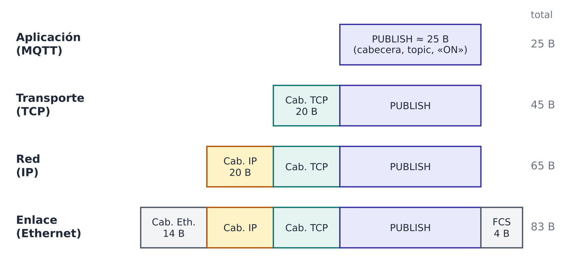

*Figura 5.1: Encapsulamiento de un mensaje PUBLISH al bajar por la pila TCP/IP. Fuente: elaboración propia.*

**Capa de aplicación.** MQTT es independiente del formato de los datos: el payload podría ser texto plano y funcionaría igual. Sin embargo, en la práctica industrial y en IoT es habitual organizarlo en formato **JSON**. Así, un mismo mensaje puede llevar varias mediciones y datos que lo describen:

- **identificador** del dispositivo (`device_id`): de qué equipo proviene la medición;
- **marca de tiempo** (`timestamp`): cuándo ocurrió el evento;
- **bloque de lecturas** (`data`): los valores medidos, como temperatura, humedad o consumo;
- **metadatos** (`status`, `battery`): el estado o el nivel de batería del dispositivo.

Un ejemplo completo está en el Anexo B.

**Capa de transporte.** TCP (*Transmission Control Protocol*) ofrece una conexión **confiable** entre aplicaciones: garantiza que los datos lleguen completos, en orden y sin duplicados. No los cifra; de eso se encarga TLS (sección 6.1). Cada segmento identifica en su cabecera los puertos de origen y destino. En MQTT, cada cliente establece una conexión TCP con el broker (puerto 1883, u 8883 con TLS), y sobre ella se intercambian todos los paquetes de control.

Para lograr la confiabilidad, TCP usa cuatro mecanismos:

- **Números de secuencia:** numera los bytes transmitidos para identificar su posición en el flujo.
- **Confirmaciones (ACK):** el receptor informa el número del siguiente byte que espera recibir.
- **Retransmisión:** si ciertos datos no se confirman a tiempo, el emisor los vuelve a enviar.
- **Reensamblado:** el receptor usa los números de secuencia para reconstruir el flujo original, aunque los segmentos lleguen desordenados.

Por ejemplo, cuando un sensor publica una medición, el cliente MQTT arma el PUBLISH y entrega sus bytes a TCP, que puede dividirlos en uno o más segmentos. TCP no conoce el contenido ni los límites de los mensajes MQTT: un PUBLISH podría viajar repartido en dos segmentos, y si falta algún byte, TCP lo recupera antes de entregar el flujo al broker. Por eso MQTT no necesita preocuparse por las pérdidas mientras la conexión esté activa (sección 4.4).

**Capa de red.** IP proporciona direccionamiento lógico y transporta datagramas entre dispositivos que pueden estar en redes distintas. Cada datagrama agrega su propia cabecera al segmento TCP. Sus campos más relevantes son:

- **Dirección IP de origen:** identifica al emisor.
- **Dirección IP de destino:** identifica al receptor; en este caso, el broker.
- **Tiempo de vida** (TTL en IPv4, *Hop Limit* en IPv6): limita la cantidad de saltos del datagrama.
- **Protocolo** (en IPv6, *Siguiente cabecera*): identifica el protocolo transportado, en este caso TCP.

IP ofrece un servicio de mejor esfuerzo: no garantiza que los datagramas lleguen ni que lo hagan en orden. Esa garantía la agrega TCP.

**Capa de enlace.** Transmite la información entre dispositivos conectados al mismo enlace: encapsula los datagramas IP en tramas adecuadas para el medio, controla el acceso al medio y detecta errores. En la Smart Home intervienen Ethernet entre el router, el servidor y el AP IoT; Wi-Fi entre los AP y los dispositivos Wi-Fi; e IEEE 802.15.4 en la red Zigbee. Los switches y puntos de acceso trabajan en esta capa, con las direcciones MAC que se obtienen mediante ARP (sección 2.2).

**Capa física.** Representa y transmite los bits por el medio:

- **Wi-Fi y Zigbee:** ondas electromagnéticas en la banda de 2,4 GHz (Wi-Fi también usa 5 GHz);
- **Ethernet:** señales eléctricas por cable de cobre, o luz en el caso de la fibra óptica.

MQTT no necesita conocer estas características para funcionar.

## 5.2. Recorrido de una orden

Con todo lo anterior se puede seguir el recorrido completo de una orden: el usuario toca "encender" en la aplicación del celular y se enciende la lámpara del living. Primero se analiza el caso de un **dispositivo Wi-Fi** (un relé inteligente Shelly que controla la lámpara), porque permite seguir todas las capas del modelo TCP/IP hasta el destino. Después se describe la variante con una **lámpara Zigbee**.

En ambos casos, el celular usa la aplicación de **Home Assistant**, que se comunica con Home Assistant (en el Home Server) mediante **HTTPS/WebSocket**. Es Home Assistant el que traduce la orden a un mensaje **MQTT** y lo publica en el broker. Así, los dos protocolos comparados en la sección 4.2 conviven, cada uno donde mejor se adapta:

- **HTTP**, entre el usuario y la plataforma;
- **MQTT**, entre la plataforma y los dispositivos.

**Caso 1: dispositivo Wi-Fi** (Figuras 5.2 y 5.3)

1. **Previo.** Al encenderse, el relé obtuvo su IP por DHCP del Home Server, abrió una conexión TCP y TLS con el broker (puerto 8883), envió CONNECT y se suscribió a `casa/living/luz/set`.
2. **En el celular.** La aplicación envía la orden a Home Assistant: la capa de aplicación arma la petición, TCP la segmenta, IP le pone como destino 192.168.1.10 y Wi-Fi la transmite al router.
3. **En el router.** Como el celular y el servidor están en la misma subred, el router actúa solo como punto de acceso y switch: reenvía la trama por su MAC de destino, por el puerto LAN donde está el Home Server, sin encaminarla en capa 3.
4. **En el Home Server.** Home Assistant recibe la orden y publica `ON` en `casa/living/luz/set` con QoS 1. El broker, en el mismo equipo, consulta sus suscripciones.
5. **Hacia la red IoT.** El broker reenvía el PUBLISH al relé. El paquete sale por la segunda interfaz del servidor (192.168.20.1); si no conoce la MAC del relé, la obtiene antes mediante ARP. El AP IoT transmite la trama por Wi-Fi.
6. **En el relé.** El relé descifra el mensaje TLS, confirma con PUBACK, cierra su contacto y la lámpara se enciende.
7. **Confirmación al usuario.** El relé publica su nuevo estado en `casa/living/luz/estado` (con *Retain*). El broker lo entrega a Home Assistant, que actualiza la aplicación del celular.

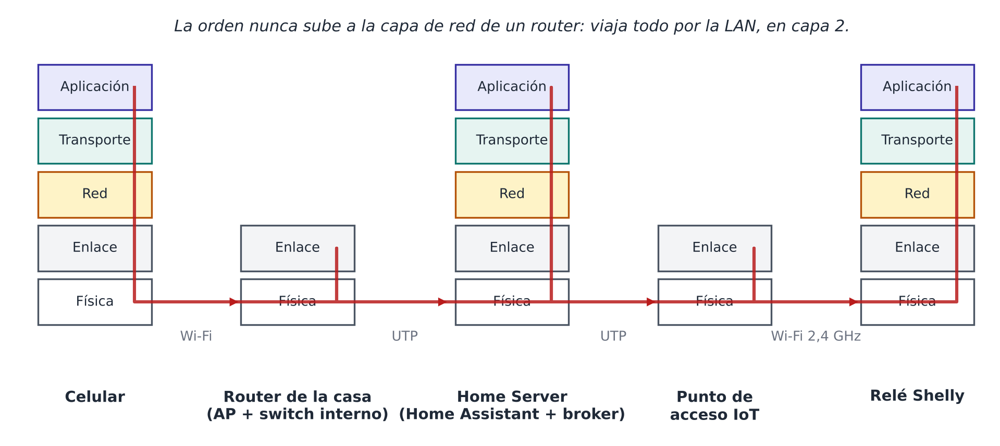

*Figura 5.2: Capas que procesa cada equipo durante el envío de la orden a un dispositivo Wi-Fi. Fuente: elaboración propia.*

Los equipos intermedios (el router y el punto de acceso IoT) solo llegan hasta la capa de enlace: leen la dirección MAC y reenvían la trama. Solo los extremos y el Home Server suben hasta la capa de aplicación. Como todo ocurre dentro de la casa, **ningún router necesita encaminar la orden en capa 3**, y ningún paquete sale a Internet.

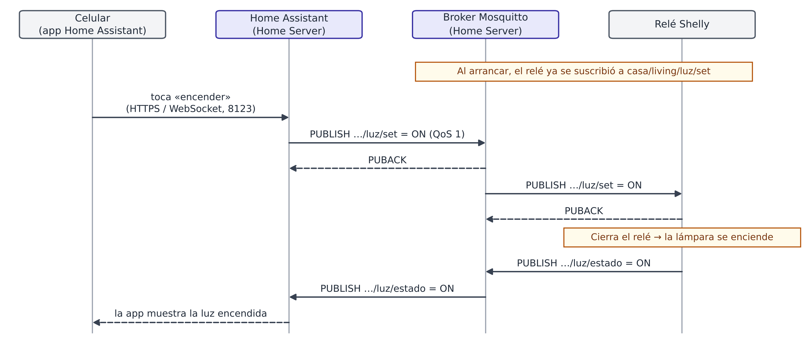

*Figura 5.3: Mensajes intercambiados con un dispositivo Wi-Fi, desde que el usuario toca "encender" hasta que la aplicación muestra la lámpara encendida. Fuente: elaboración propia.*

**Caso 2: lámpara Zigbee** (Figura 5.4)

Hasta el broker, el recorrido es el mismo: los pasos 2 a 4 no cambian. La diferencia está en el tramo final:

1. Home Assistant publica `{"state":"ON"}` en `zigbee2mqtt/foco_living/set`.
2. El broker entrega el mensaje a **Zigbee2MQTT**, que está suscrito a esos topics.
3. Zigbee2MQTT traduce la orden a un comando Zigbee y la pasa por USB al **coordinador**.
4. El coordinador la transmite por radio (IEEE 802.15.4), cifrada con AES-128. Si la lámpara está lejos, otro dispositivo de la malla la reenvía.
5. La lámpara se enciende y confirma su nuevo estado. Zigbee2MQTT lo publica en `zigbee2mqtt/foco_living`, y Home Assistant actualiza la aplicación.

En este caso, la pila TCP/IP termina en el Home Server: el último tramo usa la pila propia de Zigbee. El Home Server actúa como **pasarela** entre dos redes con protocolos distintos, que es exactamente la función que cumplen el *hub* de la marca o el asistente en un sistema comercial.

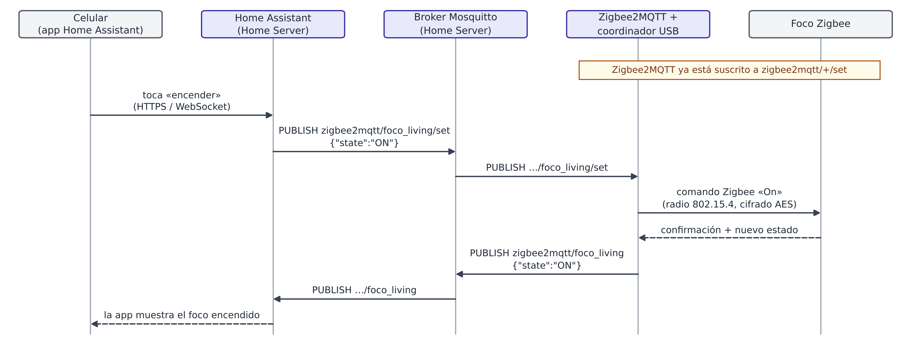

*Figura 5.4: Mensajes intercambiados con una lámpara Zigbee. Fuente: elaboración propia.*

# 6. SEGURIDAD PERIMETRAL Y FILTRADO DE TRÁFICO

En una Smart Home, la red no solo debe hacer llegar los mensajes sin errores: también debe impedir que alguien ajeno intervenga en el funcionamiento de la casa.

Los dispositivos IoT suelen tener poca capacidad de cómputo, memoria y energía, y muchos fabricantes priorizan el bajo costo y la facilidad de uso por sobre la seguridad. Si un atacante compromete un dispositivo, como una lámpara inteligente, no solo puede encenderla o apagarla: puede usarla como punto de apoyo para espiar el tráfico de la casa, robar contraseñas o atacar las computadoras y celulares de la red.

Por eso la seguridad no puede depender de una sola medida. Se organiza como una **defensa en profundidad**:

- proteger las comunicaciones con TLS;
- controlar los permisos dentro del broker;
- aislar los dispositivos mediante segmentación de la red y firewalls.

## 6.1. Seguridad en la capa de transporte (TLS)

El protocolo MQTT estándar funciona sobre TCP en el puerto 1883 y, en su configuración básica, toda la información viaja **en texto plano**. Las credenciales y los payloads (estados de sensores, comandos) quedan expuestos.

**Riesgo de intercepción y manipulación en la LAN.** Un atacante que obtenga acceso a la red (con una clave Wi-Fi comprometida o conectándose a un puerto Ethernet) puede poner su placa en modo promiscuo o envenenar las tablas ARP de los equipos (*ARP spoofing*). Así puede interceptar el tráfico entre los nodos IoT y el Home Server, lo que permite:

- **Robo de credenciales:** capturar el CONNECT y leer el usuario y la contraseña del dispositivo.
- **Espionaje:** leer los PUBLISH y saber si hay personas en la casa, qué puertas se abren o qué hábitos tienen los habitantes.
- **Inyección y suplantación:** enviar mensajes falsos haciéndose pasar por un dispositivo legítimo, por ejemplo para desactivar una alarma.
- **Ataque de repetición:** grabar los bytes de un comando, como el que abre una cerradura, y retransmitirlos más tarde, sin necesidad de descifrarlos.

**La solución: MQTT sobre TLS.** Para evitar estas vulnerabilidades se usa MQTT sobre **TLS** (*Transport Layer Security*), en el puerto TCP 8883. TLS se ubica entre TCP y MQTT, de modo que MQTT no cambia: solo viaja dentro de un canal protegido (Figura 6.1).

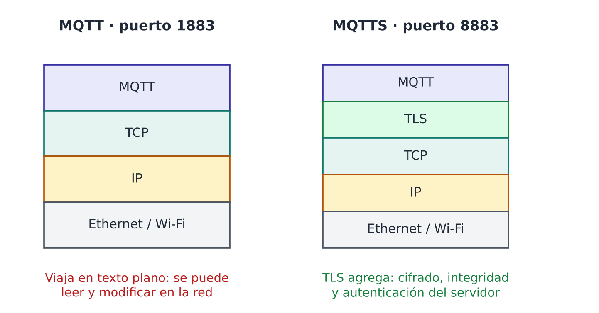

*Figura 6.1: Ubicación de TLS en la pila de protocolos. Fuente: elaboración propia.*

TLS funciona en dos fases:

1. **Negociación (*handshake*).**
   - **Autenticación del servidor:** el Home Server presenta un certificado digital (X.509) firmado por una autoridad de certificación en la que el dispositivo confía. En una casa, esa autoridad puede ser propia y estar gestionada en el mismo servidor. Así el dispositivo comprueba que habla con el broker legítimo y no con un intermediario malicioso (*man-in-the-middle*).
   - **Acuerdo de claves:** mediante criptografía asimétrica, cliente y broker acuerdan una clave simétrica de sesión.
2. **Protocolo de registro.**
   - **Confidencialidad:** los paquetes MQTT se cifran con la clave de sesión (por ejemplo, con AES). Un analizador como Wireshark solo ve bytes ilegibles.
   - **Integridad:** junto con los datos cifrados viaja un código de autenticación calculado con la clave. En TLS 1.3 se usa cifrado autenticado (AEAD, por ejemplo AES-GCM); en versiones anteriores, un HMAC. Si un tercero altera un solo bit, el receptor lo detecta y descarta el registro.
   - **Protección contra repeticiones:** cada registro usa un número de secuencia al cifrarse. Un registro grabado y reenviado no coincide con el número esperado, y el receptor lo rechaza.

| Característica | MQTT estándar | MQTT sobre TLS |
|---|---|---|
| Puerto por defecto | TCP 1883 | TCP 8883 |
| Visibilidad del tráfico | Texto plano | Cifrado |
| Autenticación del broker | No tiene | Certificado digital X.509 |
| Protección contra alteraciones | Solo sumas de verificación de TCP/IP | Código de autenticación criptográfico |
| Protección contra repeticiones | No | Sí (números de secuencia) |
| Carga sobre el dispositivo | Mínima | Mayor uso de CPU en la conexión inicial |

*Tabla 6.1: Comparación entre MQTT estándar y MQTT sobre TLS.*

## 6.2. Autenticación y control de acceso en el broker

TLS establece un canal seguro, pero no decide si un dispositivo tiene permiso para encender una luz o apagar la alarma. Para eso se necesita:

- **autenticación:** identificar quién es el cliente;
- **autorización:** definir qué puede hacer cada uno.

**Autenticación por dispositivo.** El broker debe rechazar las conexiones anónimas. Cada sensor, actuador o aplicación se autentica en el CONNECT con:

- **un identificador único** (*Client ID*), por ejemplo `sensor_temp_cocina` o `rele_living`;
- **usuario y contraseña individuales**, cargados en su firmware. Deben evitarse las credenciales compartidas por toda la instalación.

**Listas de control de acceso (ACL) del broker.** Una ACL de broker es un conjunto de reglas que define, para cada usuario, en qué topics puede publicar (escritura), suscribirse (lectura) o ambas cosas. No debe confundirse con las reglas del firewall (sección 6.3), que filtran tráfico de red y no topics. Se aplica el principio de **mínimo privilegio**: cada dispositivo recibe solo los permisos indispensables para su tarea. Por ejemplo:

- **Sensor de temperatura:** solo puede publicar en `casa/cocina/temperatura`.
- **Cerradura:** solo puede leer `casa/acceso/puerta/comando` y escribir en `casa/acceso/puerta/estado`.
- **Home Assistant:** tiene permisos amplios (`#`), porque coordina toda la casa.

Si todos los dispositivos tuvieran acceso a todo, un atacante que comprometa el sensor del patio podría publicar en `casa/seguridad/alarma`. Con una ACL bien definida, el broker rechaza ese mensaje. En el Anexo B hay un ejemplo de archivo de ACL.

## 6.3. Segmentación y filtrado de red

Muchos dispositivos IoT comerciales tienen vulnerabilidades estructurales:

- firmware que el fabricante rara vez actualiza;
- contraseñas grabadas en el código;
- puertos de diagnóstico expuestos.

Si todos los dispositivos comparten una única red plana (el mismo rango de direcciones y el mismo dominio de difusión), un dispositivo vulnerable permite a un atacante explorar el resto de la LAN. Para evitarlo se combinan dos técnicas: la **segmentación** de la red y el **filtrado** mediante firewall.

**Segmentación mediante VLAN (IEEE 802.1Q).** Una VLAN (*Virtual Local Area Network*) divide un switch físico en varias redes lógicas independientes. Cada VLAN es un dominio de difusión aislado en la capa de enlace: el *broadcast* de un dispositivo de una VLAN no llega a las otras. En una Smart Home suelen definirse tres redes lógicas:

- **gestión:** la infraestructura de red y la administración del servidor;
- **usuarios:** computadoras y celulares;
- **IoT:** sensores y actuadores.

Para separarlas, cada puerto del switch se asigna a una VLAN, y lo mismo se hace con cada red Wi-Fi: se asocia cada SSID a una etiqueta 802.1Q. Para esto hacen falta un switch administrable y puntos de acceso que soporten etiquetas por SSID.

**Dispositivos Zigbee: aislados por naturaleza.** Los dispositivos Zigbee no tienen dirección IP ni están conectados a la red de la casa: solo pueden comunicarse con el coordinador del Home Server. Un dispositivo Zigbee vulnerable no puede usarse para explorar la LAN. Esta es otra razón para preferir Zigbee en lámparas y sensores.

**Dispositivos Wi-Fi: red física separada.** Para los dispositivos Wi-Fi, en este trabajo se obtiene el mismo aislamiento que con una VLAN, con una solución más simple y económica que funciona con cualquier router y deja el control en el Home Server:

- El servidor tiene **dos interfaces de red**. La primera está conectada a la red principal; la segunda, a un punto de acceso exclusivo para los dispositivos IoT.
- La red IoT Wi-Fi es, así, una red física aparte y un dominio de difusión distinto, igual que una VLAN.
- El servidor **no reenvía paquetes** entre sus interfaces: no actúa como router entre las dos redes. Un dispositivo IoT puede comunicarse con los servicios que corren en el servidor, pero no puede usarlo para llegar a otra red.

Como resultado, la red IoT Wi-Fi no tiene salida a Internet ni acceso a la red principal.

**Filtrado mediante firewall.** Sobre esa separación, el firewall del Home Server examina cada paquete que llega comparando sus campos de cabecera (interfaz de entrada, IP de origen y destino, puertos y protocolo de transporte) con una tabla de reglas (Figura 6.2 y Tabla 6.2).

Es un firewall **con inspección de estado** (*stateful*): lleva un registro de las conexiones abiertas y deja pasar automáticamente las respuestas a una conexión permitida. En MQTT son los dispositivos IoT los que inician la conexión hacia el broker. Por eso esa conexión se **permite explícitamente**, pero solo hacia el puerto 8883 del Home Server; cualquier otra conexión iniciada desde la red IoT se bloquea.

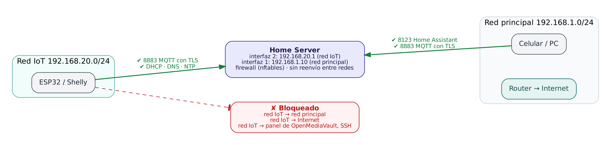

*Figura 6.2: Tráfico permitido y bloqueado entre la red IoT, el Home Server y la red principal. Fuente: elaboración propia.*

| Origen | Permitido | Bloqueado |
|---|---|---|
| Red IoT | 8883/TCP (MQTT con TLS); DHCP, DNS y NTP | Todo lo demás: administración del servidor, red principal, Internet |
| Red principal | 8123/TCP (Home Assistant); 8883/TCP; administración del servidor | Puertos no utilizados |
| Internet | 51820/UDP (VPN), reenviado por el router | Todo lo demás |

*Tabla 6.2: Reglas de filtrado del Home Server.*

## 6.4. Acceso remoto: conexión entre la LAN y la WAN

Una función esencial de una Smart Home es permitir que el usuario consulte sensores o envíe órdenes desde fuera de la casa, por la red celular (4G/5G) o desde otra red Wi-Fi. Aquí se cruzan la red privada (LAN) y la red pública (WAN).

**El problema de NAT.** Como se vio en la sección 2.2, los dispositivos de la casa usan direcciones privadas, y el router comparte una única IP pública mediante NAT. Más precisamente, NAPT (*Network Address and Port Translation*) modifica las direcciones y los puertos de los paquetes salientes y mantiene una tabla de estado.

NAT funciona de manera transparente para el tráfico que sale, pero es una barrera de una sola vía:

- deja pasar los paquetes salientes y sus respuestas;
- si un celular desde la calle envía un paquete a la IP pública de la casa, el router lo descarta, porque no sabe a qué equipo interno corresponde esa conexión no solicitada.

**Métodos de acceso remoto** (Figura 6.3):

- **Reenvío de puertos (*port forwarding*) y DNS dinámico.**
  - **Funcionamiento:** se configura una regla en el router para que todo paquete que llegue a un puerto de la IP pública se redirija a la IP y el puerto del Home Server. Con DNS dinámico se asocia un nombre de dominio a la IP pública, que el proveedor puede cambiar.
  - **Limitaciones:** expone un canal directo desde Internet hacia el servidor, que queda vulnerable a escaneos de puertos, intentos de acceso por fuerza bruta y ataques de denegación de servicio. Además, no funciona si el proveedor usa **CGNAT** (*Carrier-Grade NAT*), porque en ese caso el router no recibe una IP pública propia.
- **Red privada virtual (VPN).**
  - **Funcionamiento:** se instala un servidor VPN en la casa. Fuera de casa, la aplicación VPN del celular establece un túnel cifrado con ese servidor. El celular recibe una dirección interna y accede a la casa como si estuviera conectado a su Wi-Fi.
  - **Ventajas:** el tráfico viaja cifrado por la WAN, y los servicios del Home Server quedan ocultos a Internet.
- **Túneles inversos y servicios intermediarios (*relay*).**
  - **Funcionamiento:** es la alternativa cuando el proveedor usa CGNAT. En lugar de esperar que el celular llame a la casa, el Home Server establece una conexión **saliente** permanente hacia un nodo intermediario de confianza en la nube, y el celular se conecta a ese mismo nodo.
  - **Ventajas:** como la conexión se inicia desde la LAN, atraviesa el NAT sin abrir puertos, y el tráfico viaja cifrado de extremo a extremo.

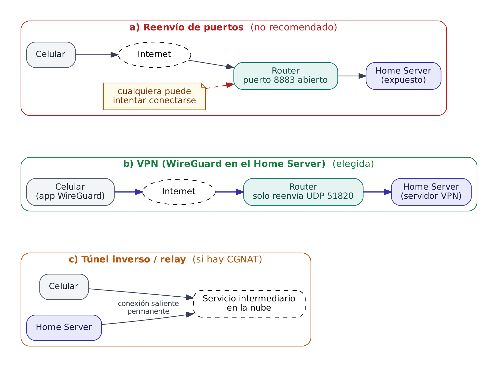

*Figura 6.3: Comparación de los métodos de acceso remoto. Fuente: elaboración propia.*

**Método elegido.** Se usa una **VPN WireGuard ejecutada en el Home Server**. El router solo reenvía un puerto, el UDP 51820, hacia el servidor. WireGuard no responde a paquetes que no estén firmados con una clave conocida, por lo que ante un escaneo ese puerto parece cerrado. Si el proveedor usa CGNAT, se recurre a un túnel inverso; por ejemplo, Tailscale, que también se basa en WireGuard.

Así, la combinación de dispositivos Zigbee sin IP, una red IoT Wi-Fi separada con filtrado en el Home Server y una VPN para el acceso desde la WAN permite controlar la casa tanto desde adentro como desde afuera sin comprometer su seguridad.

---

# 7. IMPLEMENTACIÓN PRÁCTICA

En esta sección se lleva la arquitectura analizada a equipos concretos. El criterio general es que el proyecto pueda **replicarse en cualquier vivienda**, con lo aprendido en Redes de Computadoras y comprando lo mínimo:

- **se conserva el router existente** de la casa;
- **el Home Server es una computadora reutilizada**, con software libre;
- **los dispositivos son comerciales y estándar** (Zigbee), como los que cualquier persona compraría para usar con Alexa;
- **lo único que se reemplaza es el sistema que los controla**: el asistente o la aplicación en la nube del fabricante.

La implementación se organiza en etapas que funcionan por sí solas. Con las dos primeras ya se obtiene un sistema completo; las demás son extensiones.

| Etapa | Qué agrega | Equipos |
|---|---|---|
| 1. Núcleo | El Home Server con el broker, Home Assistant y Zigbee2MQTT: el reemplazo del asistente | PC reutilizada, coordinador Zigbee USB |
| 2. Dispositivos | Una lámpara y sensores comerciales, y las automatizaciones entre ellos | Foco Zigbee, sensor de movimiento, sensor de apertura |
| 3. Dispositivos Wi-Fi (opcional) | Un dispositivo con IP que habla MQTT directamente con el broker | Relé Shelly; opcionalmente, un nodo ESP32 |
| 4. Red IoT Wi-Fi (opcional) | Aislar los dispositivos Wi-Fi detrás del Home Server | Adaptador USB-Ethernet, router en desuso como AP |
| 5. Acceso remoto | Control desde fuera de la casa | Ninguno: VPN WireGuard en el Home Server |

*Tabla 7.1: Etapas de la implementación.*

## 7.1. Arquitectura física

La Figura 7.1 muestra cómo se conectan los equipos:

- El Home Server se conecta por cable a un puerto LAN del router existente.
- El coordinador Zigbee se conecta por USB al Home Server y forma una red de malla con la lámpara y los sensores.
- Opcionalmente, una segunda interfaz de red del Home Server se conecta a un punto de acceso exclusivo para los dispositivos Wi-Fi.

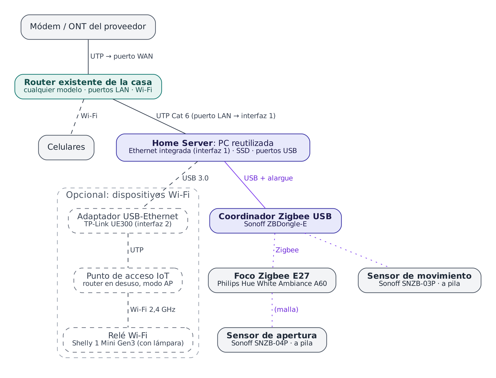

*Figura 7.1: Conexión física de los equipos, con modelos e interfaces. Fuente: elaboración propia.*

| Desde | Hacia | Medio | Interfaz o puerto |
|---|---|---|---|
| Módem/ONT del proveedor | Router | Cable UTP | Puerto WAN del router |
| Router | Home Server | Cable UTP Cat 6 | Puerto LAN del router → Ethernet integrada (interfaz 1) |
| Router | Celulares y notebooks | Wi-Fi | Red Wi-Fi de la casa |
| Home Server | Coordinador Zigbee | USB, con cable alargador | Puerto USB. El alargador aleja la antena de los puertos USB 3.0, que generan interferencia en 2,4 GHz |
| Coordinador | Foco y sensores Zigbee | IEEE 802.15.4 (2,4 GHz) | Red de malla Zigbee |
| Home Server (opcional) | AP IoT | Cable UTP | Adaptador USB-Ethernet (interfaz 2) → puerto LAN del AP |
| AP IoT (opcional) | Relé Shelly | Wi-Fi 2,4 GHz | Red Wi-Fi propia de los dispositivos IoT |

*Tabla 7.2: Interfaces y medios de conexión entre los equipos.*

## 7.2. Equipos seleccionados

| Etapa | Equipo | Modelo | Características principales | Interfaces | Función |
|---|---|---|---|---|---|
| — | Router | El existente en la vivienda | Cualquier modelo con puertos LAN y Wi-Fi | WAN, LAN, Wi-Fi | Salida a Internet (NAT), Wi-Fi y DHCP de la red principal |
| 1 | Home Server | PC reutilizada (o mini PC usada, como Lenovo ThinkCentre Tiny, Dell OptiPlex Micro o HP EliteDesk Mini) | CPU de 64 bits, 4 GB de RAM como mínimo (8 GB recomendado), disco SSD | Ethernet, USB | Broker, automatizaciones, pasarela Zigbee, VPN y firewall |
| 1 | Coordinador Zigbee | Sonoff Zigbee 3.0 USB Dongle Plus (ZBDongle-E) | Chip Silicon Labs EFR32MG21, antena externa, compatible con Zigbee2MQTT | USB; radio IEEE 802.15.4 en 2,4 GHz | Crea la red Zigbee y conecta los dispositivos con el Home Server |
| 2 | Foco inteligente | Philips Hue White Ambiance A60 E27 (929002468401) | Luz blanca de cálida a fría, regulable, rosca E27 | Zigbee 3.0 y Bluetooth | Actuador: la lámpara que se enciende y apaga |
| 2 | Sensor de movimiento | Sonoff SNZB-03P | Sensor infrarrojo pasivo (PIR) con sensor de luminosidad, a pila | Zigbee 3.0 | Detecta presencia y dispara automatizaciones |
| 2 | Sensor de apertura | Sonoff SNZB-04P | Contacto magnético para puertas y ventanas, a pila | Zigbee 3.0 | Avisa cuando se abre una puerta o ventana |
| 3 (opcional) | Relé inteligente | Shelly 1 Mini Gen3 | Relé de hasta 8 A, de 29 × 34 × 16 mm, alimentado con 110–240 V (fase y neutro), MQTT nativo | Wi-Fi 2,4 GHz, Bluetooth, entrada para llave de luz | Actuador Wi-Fi que habla MQTT directamente con el broker. Se instala detrás de la llave de luz o dentro de la lámpara; la instalación la realiza un electricista |
| 3 (opcional) | Nodo IoT | Espressif ESP32-WROOM-32 DevKit V1 | Microcontrolador con Wi-Fi, 2 núcleos a 240 MHz | Wi-Fi 2,4 GHz, Bluetooth, GPIO, I2C, SPI | Sensor a medida, para mediciones que no se venden ya armadas |
| 4 (opcional) | Segunda interfaz de red | TP-Link UE300 | Adaptador USB 3.0 a Gigabit Ethernet, reconocido por Linux sin controladores adicionales | USB 3.0 / RJ-45 | Interfaz 2 del Home Server, hacia la red IoT Wi-Fi |
| 4 (opcional) | Punto de acceso IoT | Router en desuso, en modo punto de acceso | Wi-Fi de 2,4 GHz | LAN, Wi-Fi | Red Wi-Fi exclusiva para los dispositivos IoT |

*Tabla 7.3: Equipos seleccionados para la implementación.*

Los dispositivos Zigbee indicados son una referencia. Puede usarse cualquier lámpara o sensor Zigbee 3.0 que figure en la lista de dispositivos compatibles de Zigbee2MQTT, lo que permite elegir según el precio y la disponibilidad. Los dispositivos Zigbee que están siempre conectados a la red eléctrica, como el foco, además reenvían los mensajes de los sensores y extienden el alcance de la malla. Por eso el foco debe quedar con la llave de pared siempre encendida.

**Fotografías de los equipos**

Las Figuras 7.2 a 7.7 muestran los equipos seleccionados.

<table>
<tr>
<td align="center">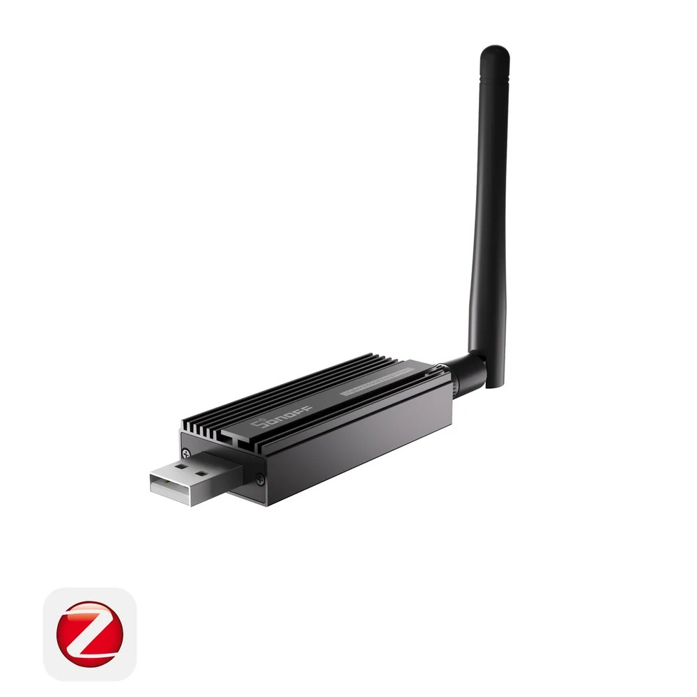<br><em>Figura 7.2: Coordinador Zigbee Sonoff ZBDongle-E. Fuente: Sonoff.</em></td>
<td align="center">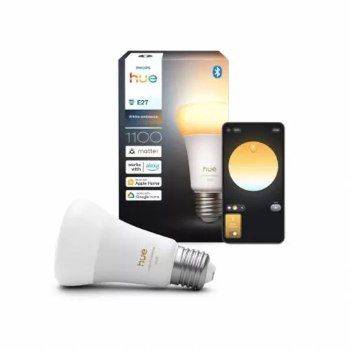<br><em>Figura 7.3: Foco Philips Hue White Ambiance A60 E27. Fuente: Philips Argentina.</em></td>
</tr>
<tr>
<td align="center">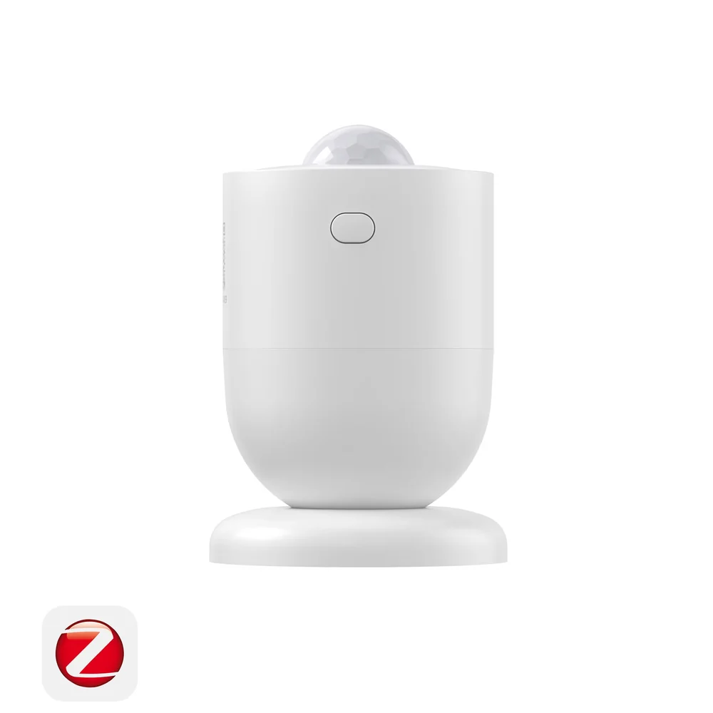<br><em>Figura 7.4: Sensor de movimiento Sonoff SNZB-03P. Fuente: Sonoff.</em></td>
<td align="center">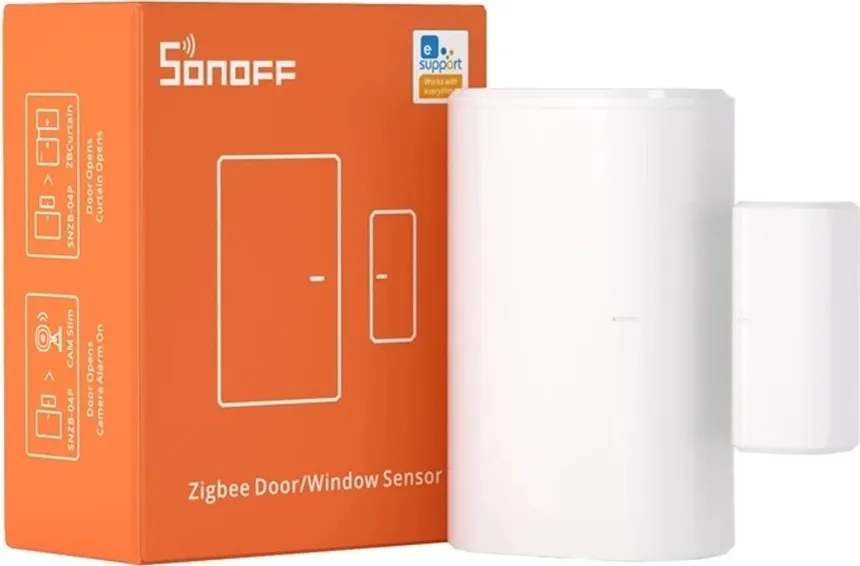<br><em>Figura 7.5: Sensor de apertura Sonoff SNZB-04P. Fuente: Sonoff Argentina.</em></td>
</tr>
<tr>
<td align="center">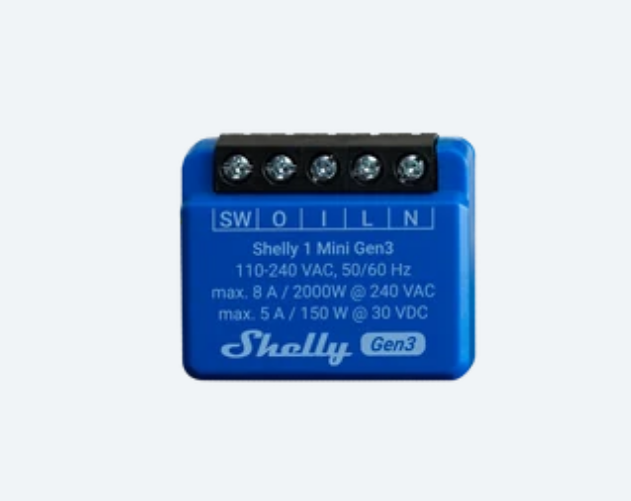<br><em>Figura 7.6: Relé Shelly 1 Mini Gen3 (opcional). Fuente: Shelly.</em></td>
<td align="center">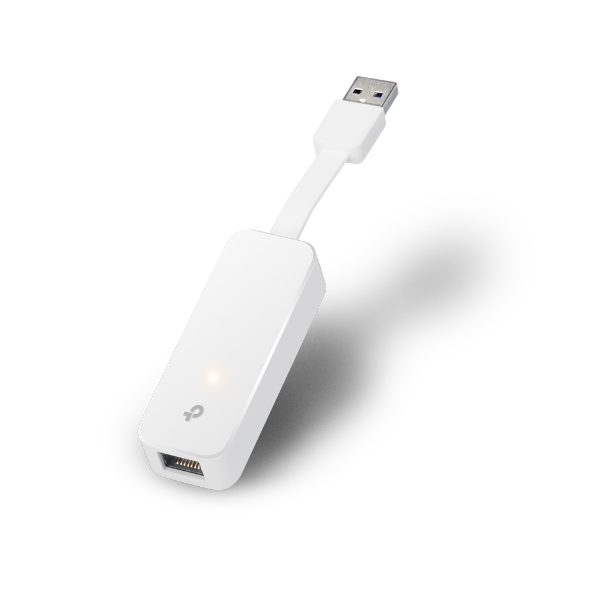<br><em>Figura 7.7: Adaptador USB-Ethernet TP-Link UE300 (opcional). Fuente: TP-Link.</em></td>
</tr>
</table>

## 7.3. Software del Home Server

Todo el software del Home Server es libre y gratuito. Su organización se mostró en la Figura 3.1.

| Software | Qué hace en el sistema | Etapa |
|---|---|---|
| Debian 13 | Sistema operativo del servidor | 1 |
| OpenMediaVault 8 | Panel web de administración: discos, red, usuarios, copias de seguridad y contenedores | 1 |
| Docker | Ejecuta cada servicio aislado en su propio contenedor | 1 |
| Eclipse Mosquitto | Broker MQTT | 1 |
| Home Assistant | Automatizaciones, panel de control, aplicación para el celular y asistente de voz | 1 |
| Zigbee2MQTT | Traduce los mensajes Zigbee a MQTT | 1 |
| ESPHome | Firmware del nodo ESP32 | 3 (opcional) |
| dnsmasq y chrony | DHCP, DNS y hora de la red IoT Wi-Fi | 4 (opcional) |
| nftables | Firewall del servidor | 1 y 4 |
| WireGuard | VPN para el acceso desde fuera de la casa | 5 |

*Tabla 7.4: Software utilizado en el Home Server.*

**Debian y OpenMediaVault.** **Debian** es una distribución de Linux orientada a servidores, conocida por su estabilidad. Sobre ella se instala **OpenMediaVault** (OMV), un sistema para armar un servidor de almacenamiento en red. OMV agrega una interfaz web que permite administrar el equipo desde el navegador, sin usar la terminal:

- los discos y las copias de seguridad;
- los usuarios;
- la configuración de las interfaces de red;
- las actualizaciones y el estado del hardware.

Con el complemento *Compose* del repositorio *omv-extras*, también se administran desde ahí los contenedores. OMV permite, además, que el mismo equipo funcione como almacenamiento de la casa.

**Contenedores.** Cada servicio corre en un contenedor **Docker**: un entorno aislado que incluye el programa con todo lo que necesita. Así, los servicios no interfieren entre sí y cada uno puede actualizarse o reemplazarse sin afectar a los demás. Al contenedor de Zigbee2MQTT se le da acceso al puerto USB del coordinador.

**Broker: Eclipse Mosquitto.** Es el broker MQTT de código abierto más utilizado. Se configura con:

- TLS en el puerto 8883, con un certificado emitido por una autoridad de certificación propia;
- un usuario y una contraseña por cliente;
- un archivo de ACL (sección 6.2).

El puerto 1883, sin cifrado, queda limitado al propio servidor.

**Pasarela Zigbee: Zigbee2MQTT.** Traduce entre Zigbee y MQTT usando el coordinador USB. Para sumar un dispositivo nuevo se habilita la vinculación desde su panel web y se pone el dispositivo en modo de vinculación; Zigbee2MQTT lo identifica y le asigna un nombre. A partir de ahí:

- publica el estado de cada dispositivo como JSON, por ejemplo `{"occupancy": true}` en `zigbee2mqtt/sensor_pasillo`;
- recibe las órdenes en `zigbee2mqtt/<nombre>/set`, por ejemplo `{"state": "ON"}` para la lámpara;
- publica también la descripción de cada dispositivo en topics que empiezan con `homeassistant/`, para que Home Assistant cree sus entidades de forma automática.

Para el resto del sistema, un dispositivo Zigbee es un cliente MQTT más. Es el rol de pasarela que la sección 3.1 asigna al Home Server.

**Automatizaciones: Home Assistant.** Es la plataforma de domótica de código abierto más difundida y el reemplazo directo del asistente comercial. Para el broker, es un cliente más:

- se suscribe a los topics de estado y publica órdenes cuando se cumple una regla, por ejemplo: "si el sensor del pasillo detecta movimiento y es de noche, encender la lámpara durante dos minutos";
- ofrece el panel y la aplicación del celular, que se comunican con él por HTTPS en el puerto 8123 (sección 5.2);
- incluye el asistente **Assist**, que permite dar órdenes por voz desde la aplicación, como con Alexa;
- guarda el historial de los dispositivos.

Se instala en su versión ***Container***, que corre en Docker. Desde 2025, Home Assistant solo da soporte a dos formas de instalación: *Home Assistant OS*, que ocupa toda la máquina, y *Container*, que permite compartir el servidor con OMV (Home Assistant, 2025). Por eso, el broker y la pasarela Zigbee corren en contenedores propios.

**Dispositivos Wi-Fi (opcional).** El relé Shelly trae MQTT en su firmware: desde su página web se activa la opción MQTT y se indican la dirección del broker y las credenciales. Para un sensor a medida, el ESP32 se programa con **ESPHome**: el dispositivo se describe en un archivo de texto (qué sensor, en qué pin y a qué broker se conecta) y ESPHome genera el firmware.

**Servicios de red.**

- **nftables** es el firewall de Linux, con inspección de estado. Aplica las reglas de la Tabla 6.2.
- **dnsmasq** (solo si se usa la red IoT Wi-Fi) asigna las direcciones por DHCP en la segunda interfaz, con reservas por MAC, y resuelve nombres como `broker.casa`.
- **chrony** (ídem) ofrece la hora a la red IoT Wi-Fi, que no tiene acceso a Internet. TLS la necesita para verificar que el certificado del broker esté vigente.

**VPN: WireGuard.** Cada equipo (el servidor y cada celular) tiene un par de claves, pública y privada. El celular establece un túnel cifrado sobre UDP hacia el puerto 51820 y, una vez conectado, usa la aplicación de Home Assistant como si estuviera en la casa. Si el proveedor usa CGNAT, se reemplaza por Tailscale, que también se basa en WireGuard.

## 7.4. Presupuesto estimado

El presupuesto se organiza según las etapas de la Tabla 7.1. Como se conservan el router y una computadora existentes, la inversión del sistema básico (etapas 1 y 2) se limita al coordinador Zigbee y a los dispositivos. Precios en pesos argentinos, consultados el 9 de noviembre de 2026 en tiendas que venden en el país (los enlaces están en el Anexo D).

| Etapa | Equipo | Modelo | Cant. | Precio unitario | Tienda |
|---|---|---|---|---|---|
| — | Router | Router existente de la vivienda | 1 | \$0 | — |
| 1 | Home Server | PC reutilizada | 1 | \$0 | — |
| 1 | Coordinador Zigbee | Sonoff ZBDongle-E | 1 | \$79.900 | HomIQ |
| 1 | Alargue USB | Cable alargue USB 2.0 macho-hembra, 1 m | 1 | \$3.992 | Velko |
| 1 | Cable de red | Patch cord UTP Cat 6, 2 m (Reguvolt) | 1 | \$2.657 | Córdoba Electrónica |
| 2 | Foco inteligente | Philips Hue White Ambiance A60 E27 | 1 | \$47.990 | Tienda oficial Philips |
| 2 | Sensor de movimiento | Sonoff SNZB-03P | 1 | \$39.990 | HomIQ |
| 2 | Sensor de apertura | Sonoff SNZB-04P | 1 | \$35.990 | HomIQ |
| | **Subtotal: sistema básico (etapas 1 y 2)** | | | **\$210.519** | |
| 3 (opcional) | Relé inteligente | Shelly 1 Mini Gen3 | 1 | \$52.999 | L2B |
| 3 (opcional) | Nodo IoT | ESP32-WROOM-32 DevKit V1 | 1 | \$18.559 | Starware |
| 4 (opcional) | Adaptador USB-Ethernet | TP-Link UE300 | 1 | \$28.079 | Venex |
| 4 (opcional) | Punto de acceso IoT | Router en desuso | 1 | \$0 | — |
| 5 | VPN | WireGuard (software libre) | — | \$0 | — |
| | **Total con opcionales** | | | **\$310.156** | |

*Tabla 7.5: Presupuesto estimado.*

Los precios corresponden al precio de lista de cada tienda. Algunas ofrecen descuentos por transferencia (por ejemplo, el adaptador TP-Link UE300 baja a \$25.999 en Venex). Al momento de la consulta, el coordinador Zigbee y el adaptador USB-Ethernet figuraban sin stock en esas tiendas, por lo que su precio se toma como referencia; ambos se consiguen también en otros comercios y en Mercado Libre. La instalación del relé Shelly (opcional) requiere un electricista, cuyo costo no está incluido. Los dispositivos Zigbee, en cambio, no requieren instalación: el foco se enrosca y los sensores se pegan o se apoyan.

Reutilizar una computadora como Home Server y el router existente es el mayor ahorro del proyecto. Una Raspberry Pi 5 de 8 GB, la alternativa considerada inicialmente para el servidor, costaba \$416.212, y un router nuevo como el TP-Link Archer AX23, \$126.778.

## 7.5. Justificación de la solución

Al elegir los equipos no se buscaron los más potentes, sino los que permiten replicar el proyecto en cualquier vivienda con la mejor relación entre costo y prestaciones. Los criterios fueron cuatro:

- que todo funcione dentro de la red local, sin depender de la nube;
- que los dispositivos sean estándar y compatibles con MQTT, directamente o a través de una pasarela;
- que se aproveche lo que ya existe en la casa;
- que los equipos sean fáciles de conseguir y configurar.

**Router existente.** Como la lógica y la seguridad están en el Home Server, al router solo se le pide lo básico: un puerto LAN libre, Wi-Fi y, para el acceso remoto, la posibilidad de reenviar un puerto. Cualquier router doméstico, incluido el que entrega el proveedor, cumple estos requisitos.

**Home Server (PC reutilizada con Debian y OpenMediaVault).** En lugar de depender de un asistente o de un *hub* comercial, que se apoyan en la nube del fabricante, se reutiliza una computadora que ya no se usa: para el broker y las automatizaciones alcanza con un equipo modesto. Frente a una Raspberry Pi, una PC trae disco SSD (la tarjeta microSD se desgasta con escrituras continuas), admite una segunda placa de red y puede servir también como almacenamiento de la casa. Como contrapartida, consume más energía.

**Dispositivos Zigbee.** Es la decisión central del proyecto. Las lámparas y sensores Wi-Fi más baratos suelen depender de la nube de su fabricante y son difíciles de controlar en forma local. Los dispositivos Zigbee, en cambio:

- funcionan con cualquier coordinador compatible, sin la nube de su marca;
- son estándar y se fabrican en muchas marcas y para muchos usos (lámparas, enchufes, llaves de luz y sensores de movimiento, apertura, temperatura, humo o agua);
- consumen muy poca energía, por lo que los sensores funcionan durante meses o años a pila;
- no tienen dirección IP, por lo que quedan aislados de la red de la casa (sección 6.3).

**Coordinador Sonoff ZBDongle-E.** Es uno de los coordinadores USB más difundidos y está soportado por Zigbee2MQTT. Es la única compra obligatoria de la etapa 1: cumple el papel del *hub* que traen los sistemas comerciales.

**Relé Shelly 1 Mini Gen3 (opcional).** Se elige porque trae MQTT en su firmware, de modo que se conecta directamente al broker local sin modificaciones, y porque se consigue en el país. Se descartó el enchufe Shelly Plug S Gen3, que no tiene distribución local y usa ficha europea. Permite mostrar un dispositivo con dirección IP y el recorrido completo por las capas del modelo TCP/IP (sección 5.2).

**Implementación por etapas.** Con las etapas 1 y 2 ya se obtiene un sistema funcional: una lámpara comercial que se enciende sola cuando un sensor detecta movimiento, sin asistente en la nube y sin depender de Internet. Las etapas siguientes agregan dispositivos Wi-Fi, el aislamiento de la red IoT Wi-Fi y el acceso remoto.

# 8. CONCLUSIONES

En esta monografía se analizó una casa inteligente como un caso concreto de red de computadoras, siguiendo el recorrido de la información desde el dispositivo del usuario hasta los sensores y actuadores de la vivienda. Este enfoque permitió comprobar que una acción tan simple como encender una lámpara desde el celular requiere la cooperación de todas las capas del modelo TCP/IP.

En cuanto a la infraestructura, la red local doméstica, organizada en una topología en estrella con router, switch y puntos de acceso, es la base sobre la que opera todo el sistema. Se destacó la importancia de que el Home Server tenga siempre la misma dirección, ya que es el destino de todos los mensajes MQTT. También se describió el papel de ARP y de los switches para entregar cada trama al dispositivo correcto.

El Home Server se presentó como el núcleo de la casa inteligente: concentra la lógica de control, aloja el broker MQTT y traduce entre las distintas tecnologías de los dispositivos. De este modo aplica el principio de ubicar la inteligencia en los sistemas finales y no en la red. La comparación con la topología en la nube mostró que el procesamiento local:

- reduce el retardo, porque evita los múltiples saltos y colas de la WAN;
- mejora la privacidad;
- elimina la dependencia de servidores externos.

En consecuencia, si se pierde la conexión a Internet, el broker, las automatizaciones y el control desde la red local siguen funcionando, y solo se pierde el acceso remoto.

Respecto de la comunicación, MQTT resultó adecuado para este escenario. Su modelo de publicación/suscripción desacopla a los dispositivos, permite que un mismo mensaje llegue a varios destinatarios y hace que el broker entregue la información en el momento, sin consultas periódicas. Frente a HTTP, sus mensajes son considerablemente más livianos: 25 bytes frente a 109 en el ejemplo calculado. Su consumo energético también es menor, aunque la diferencia medida en la bibliografía es moderada. HTTP sigue siendo útil para la interfaz del usuario, por lo que ambos protocolos conviven: HTTP entre el usuario y la plataforma, y MQTT entre la plataforma y los dispositivos.

Los niveles de QoS permiten ajustar la garantía de entrega a la importancia de cada mensaje:

- QoS 0 para las lecturas periódicas;
- QoS 1 para los comandos y estados que pueden repetirse sin consecuencias;
- QoS 2 solo para los casos críticos en los que un duplicado sería inaceptable.

Como MQTT funciona sobre TCP, estos niveles actúan cuando la conexión se interrumpe, no ante pérdidas de paquetes individuales, que TCP ya resuelve.

El análisis por capas mostró cómo se reparten las responsabilidades:

- MQTT define los mensajes;
- TCP garantiza la entrega confiable y ordenada de los bytes;
- IP se encarga del direccionamiento y el encaminamiento;
- Ethernet, Wi-Fi e IEEE 802.15.4 transportan las tramas en cada enlace.

En el recorrido de una orden, la aplicación del celular envía la orden a Home Assistant, que la publica en el broker; el broker la reenvía al dispositivo suscrito (directamente, si es Wi-Fi, o a través de Zigbee2MQTT y el coordinador, si es Zigbee), y el dispositivo enciende la lámpara y publica su nuevo estado. Los equipos intermedios solo actúan en la capa de enlace, y ningún paquete sale de la casa.

El trabajo también mostró que la seguridad no puede depender de un único mecanismo. MQTT, por sí solo, transmite en texto plano, por lo que el diseño propuesto combina varias capas de defensa:

- TLS para cifrar la comunicación, verificar su integridad y autenticar al broker;
- credenciales individuales y ACL en el broker, según el principio de mínimo privilegio;
- dispositivos Zigbee, que no tienen dirección IP, y una red separada para los dispositivos Wi-Fi, a la que solo accede el Home Server, con su propio firewall;
- acceso remoto mediante una VPN, en lugar de exponer puertos a Internet.

En la implementación, el proyecto puede replicarse en cualquier vivienda: se conservan el router existente y dispositivos comerciales estándar, como los que se usan con Alexa, y se reemplaza solo el sistema que los controla por un Home Server armado con una computadora reutilizada, Debian, OpenMediaVault y software libre. Con un coordinador Zigbee, una lámpara y un par de sensores ya se obtiene un sistema completo que funciona sin la nube del fabricante.

La principal limitación de esta arquitectura es que el Home Server se convierte en un **punto único de falla**: si deja de funcionar, la casa inteligente deja de responder. El diseño acota el impacto, porque el router conserva la red y la salida a Internet de la casa aunque el servidor falle. Una fuente de alimentación ininterrumpida (UPS), las copias de seguridad automáticas y, como extensión de este trabajo, la redundancia del broker permitirían reducir este riesgo.

En síntesis, una Smart Home basada en un Home Server con broker MQTT local es una arquitectura eficiente y de baja latencia, que no depende de Internet para su funcionamiento básico y que resulta segura si se aplican las medidas adecuadas. A la vez, constituye un ejemplo cotidiano que integra los principales contenidos de Redes de Computadoras.

---

# 9. BIBLIOGRAFÍA

- Banerjee, A., et al. (2017). Implementación de casas inteligentes seguras usando infraestructura existente. *Sistemas & Telemática, 15*(43).
- Camacho-León, S., González-Guerrero, E. y Peña-Ortega, R. (2023). Comparative Analysis of Power Consumption between MQTT and HTTP Protocols in an IoT Platform Designed and Implemented for Remote Real-Time Monitoring of Long-Term Cold Chain Transport Operations. *Sensors, 23*(10), 4896. https://doi.org/10.3390/s23104896
- Cheshire, S. y Krochmal, M. (2013). *Multicast DNS* (RFC 6762). IETF. https://www.rfc-editor.org/info/rfc6762
- Donenfeld, J. A. (2017). WireGuard: Next Generation Kernel Network Tunnel. *Network and Distributed System Security Symposium (NDSS)*.
- Fielding, R. T. (2000). *Architectural Styles and the Design of Network-based Software Architectures* [Tesis doctoral]. University of California, Irvine. https://ics.uci.edu/~fielding/pubs/dissertation/top.htm
- Fielding, R., Nottingham, M. y Reschke, J. (Eds.). (2022). *HTTP Semantics* (RFC 9110). IETF. https://www.rfc-editor.org/info/rfc9110
- Fielding, R., Nottingham, M. y Reschke, J. (Eds.). (2022). *HTTP/1.1* (RFC 9112). IETF. https://www.rfc-editor.org/info/rfc9112
- Home Assistant. (s.f.). *Documentación de Home Assistant*. Recuperado el 9 de noviembre de 2026 de https://www.home-assistant.io/docs/
- Home Assistant. (2025, 22 de mayo). *Deprecating Core and Supervised installation methods, and 32-bit systems*. https://www.home-assistant.io/blog/2025/05/22/deprecating-core-and-supervised-installation-methods-and-32-bit-systems/
- IEEE. (2020). *IEEE Standard for Low-Rate Wireless Networks* (IEEE Std 802.15.4-2020).
- Kurose, J. F. y Ross, K. W. (2017). *Redes de computadoras: un enfoque descendente* (7.ª ed.). Pearson.
- Montenegro, G., Kushalnagar, N., Hui, J. y Culler, D. (2007). *Transmission of IPv6 Packets over IEEE 802.15.4 Networks* (RFC 4944). IETF. https://www.rfc-editor.org/info/rfc4944
- OASIS. (2019). *MQTT Version 5.0* (A. Banks, E. Briggs, K. Borgendale y R. Gupta, Eds.). OASIS Standard. https://www.oasis-open.org/standard/mqtt-v5-0-os/
- Ramos, F. (s.f.). [Entrada de blog sobre servicios autoalojados en el hogar]. https://blog.fidelramos.net/es/software/self-hosted-home-1
- Rekhter, Y., Moskowitz, B., Karrenberg, D., de Groot, G. J. y Lear, E. (1996). *Address Allocation for Private Internets* (RFC 1918). IETF. https://www.rfc-editor.org/info/rfc1918
- Rescorla, E. (2018). *The Transport Layer Security (TLS) Protocol Version 1.3* (RFC 8446). IETF. https://www.rfc-editor.org/info/rfc8446
- Stallings, W. (2004). *Comunicaciones y redes de computadores* (7.ª ed.). Pearson Educación.
- Debian. (s.f.). *Documentación de Debian*. Recuperado el 9 de noviembre de 2026 de https://www.debian.org/doc/
- Eclipse Foundation. (s.f.). *Eclipse Mosquitto: documentación*. Recuperado el 9 de noviembre de 2026 de https://mosquitto.org/documentation/
- OpenMediaVault. (s.f.). *Documentación de OpenMediaVault*. Recuperado el 9 de noviembre de 2026 de https://docs.openmediavault.org/
- Philips Hue. (s.f.). *Hue White Ambiance A60 E27* [Hoja de producto]. Recuperado el 9 de noviembre de 2026 de https://www.philips-hue.com/
- Shelly. (s.f.). *Shelly 1 Mini Gen3* [Documentación del producto]. Recuperado el 9 de noviembre de 2026 de https://www.shelly.com/blogs/documentation/shelly-1-mini-gen3
- Sonoff. (s.f.). *Zigbee 3.0 USB Dongle Plus (ZBDongle-E), SNZB-03P y SNZB-04P* [Hojas de producto]. Recuperado el 9 de noviembre de 2026 de https://sonoff.tech/
- WireGuard. (s.f.). *WireGuard: fast, modern, secure VPN tunnel*. Recuperado el 9 de noviembre de 2026 de https://www.wireguard.com/
- Zigbee2MQTT. (s.f.). *Documentación y lista de dispositivos compatibles*. Recuperado el 9 de noviembre de 2026 de https://www.zigbee2mqtt.io/

---

# ANEXO A — Cálculo del overhead de HTTP y MQTT

Se cuentan los bytes de **capa de aplicación** necesarios para encender una lámpara con el mensaje `ON`. No se incluyen las cabeceras TCP, IP ni de enlace, que son iguales para ambos protocolos.

**HTTP: petición y respuesta mínimas.** Cada salto de línea (`\r\n`) cuenta como 2 bytes.

```
PUT /living/luz HTTP/1.1\r\n
Host: homeserver.lan\r\n
Content-Length: 2\r\n
\r\n
ON
```

La petición ocupa 71 bytes.

```
HTTP/1.1 200 OK\r\n
Content-Length: 0\r\n
\r\n
```

La respuesta ocupa 38 bytes. **Total: 109 bytes.** Un cliente HTTP real agrega más cabeceras (`User-Agent`, `Accept`, `Content-Type`, cookies), por lo que en la práctica el intercambio pesa bastante más.

**MQTT: PUBLISH con QoS 0** (MQTT 3.1.1, topic `casa/living/luz/set`)

| Campo | Bytes |
|---|---|
| Cabecera fija (tipo de paquete y banderas + longitud restante) | 2 |
| Longitud del topic | 2 |
| Topic `casa/living/luz/set` (19 caracteres) | 19 |
| Payload `ON` | 2 |
| **Total** | **25** |

**MQTT con QoS 1 y QoS 2:**

- **QoS 1:** el PUBLISH agrega un identificador de paquete de 2 bytes (27 bytes), y el PUBACK ocupa 4 bytes (cabecera fija + identificador). **Total: 31 bytes.**
- **QoS 2:** PUBLISH de 27 bytes más PUBREC, PUBREL y PUBCOMP de 4 bytes cada uno. **Total: 39 bytes.**

En MQTT 5, el PUBLISH incluye además un byte de longitud de propiedades (26 bytes con QoS 0). Las confirmaciones pueden seguir ocupando 4 bytes cuando el resultado es exitoso.

---

# ANEXO B — Ejemplos de configuración

**B.1. Payload en formato JSON**

```json
{
  "device_id": "sensor_temp_01",
  "timestamp": "2026-10-21T20:30:00Z",
  "data": {
    "temperature": 23.5,
    "humidity": 60.2,
    "battery": 95
  },
  "status": "ok"
}
```

**B.2. Árbol de topics de la Smart Home**

```
casa/
├── cocina/
│   ├── temperatura        (sensor publica, QoS 0)
│   └── luz/
│       ├── set            (Home Assistant publica la orden, QoS 1)
│       └── estado         (el dispositivo publica su estado, QoS 1, retain)
├── living/
│   ├── luz/set
│   ├── luz/estado
│   └── persiana/set
├── acceso/
│   └── puerta/
│       ├── comando
│       └── estado
└── seguridad/
    └── alarma
zigbee2mqtt/
├── foco_living            (estado de la lámpara, publicado por Zigbee2MQTT)
├── foco_living/set        (Home Assistant publica la orden: {"state":"ON"})
├── sensor_pasillo         (movimiento: {"occupancy":true}, QoS 1)
└── sensor_puerta          (apertura: {"contact":false}, QoS 1)
homeassistant/...          (descripción de los dispositivos para el descubrimiento automático)
```

**B.3. Archivo de ACL de Mosquitto**

```
# Relé Shelly del living: recibe órdenes y publica su estado
user rele_living
topic read  casa/living/luz/set
topic write casa/living/luz/estado

# Sensor de temperatura de la cocina: solo publica su medición
user sensor_temp_cocina
topic write casa/cocina/temperatura

# Zigbee2MQTT: representa a los dispositivos Zigbee
user zigbee2mqtt
topic readwrite zigbee2mqtt/#
topic write homeassistant/#

# Home Assistant: coordina toda la casa
user homeassistant
topic readwrite casa/#
topic readwrite zigbee2mqtt/#
topic read homeassistant/#
```

---

# ANEXO C — Glosario de siglas

| Sigla | Significado | Descripción breve |
|---|---|---|
| ACK | *Acknowledgment* | Confirmación de recepción |
| ACL | *Access Control List* | Lista de reglas de permisos (en el broker o en el firewall) |
| AEAD | *Authenticated Encryption with Associated Data* | Cifrado que también garantiza integridad (TLS 1.3) |
| AP | *Access Point* | Punto de acceso inalámbrico |
| ARP | *Address Resolution Protocol* | Obtiene la dirección MAC a partir de la IP |
| CGNAT | *Carrier-Grade NAT* | NAT aplicado por el proveedor; el cliente no recibe IP pública |
| DHCP | *Dynamic Host Configuration Protocol* | Asigna direcciones IP automáticamente |
| DNS | *Domain Name System* | Traduce nombres a direcciones IP |
| HTTP | *Hypertext Transfer Protocol* | Protocolo de la web, de petición/respuesta |
| IoT | *Internet of Things* | Internet de las Cosas |
| LAN / WAN | *Local / Wide Area Network* | Red de área local / de área amplia |
| MAC | *Media Access Control* | Dirección física de una placa de red |
| mDNS | *Multicast DNS* | Resolución de nombres sin servidor, por multicast |
| MQTT | — | Protocolo de mensajería de publicación/suscripción |
| NAT / NAPT | *Network Address (and Port) Translation* | Traducción de direcciones (y puertos) privadas a públicas |
| NTP | *Network Time Protocol* | Sincronización de la hora |
| OMV | OpenMediaVault | Sistema de administración del servidor |
| QoS | *Quality of Service* | Calidad de servicio; en MQTT, garantía de entrega |
| SSID | *Service Set Identifier* | Nombre de una red Wi-Fi |
| TCP | *Transmission Control Protocol* | Transporte confiable y ordenado |
| TLS | *Transport Layer Security* | Cifrado y autenticación de la comunicación |
| VLAN | *Virtual LAN* | Red lógica separada dentro de un mismo switch |
| VPN | *Virtual Private Network* | Túnel cifrado para acceder a la red desde afuera |
| WPAN | *Wireless Personal Area Network* | Red inalámbrica de corto alcance (por ejemplo, Zigbee) |
| Zigbee | — | Estándar inalámbrico de bajo consumo sobre IEEE 802.15.4, sin IP, con topología de malla |

---

# ANEXO D — Fuentes de los precios

Precios consultados el 9 de noviembre de 2026.

| Equipo | Tienda | Enlace | Observaciones |
|---|---|---|---|
| Sonoff ZBDongle-E | HomIQ | https://tienda.homiq.com.ar/productos/sonoff-zigbee-dongle-e-usb/ | Sin stock al momento de la consulta |
| Cable alargue USB 2.0, 1 m | Velko | https://velko.com.ar/productos/cable-alargue-1m-usb | 5 % de descuento por transferencia |
| Patch cord UTP Cat 6, 2 m | Córdoba Electrónica | https://tienda.cordobaelectronica.com.ar/productos/patch-cord-utp-cat-6-elegir-longitud-reguvolt-rv-pcord6/ | — |
| Philips Hue White Ambiance A60 E27 | Tienda oficial Philips Argentina | https://www.tienda.philips.com.ar/929002468401/p | Precio de oferta (lista: \$56.990) |
| Sonoff SNZB-03P | HomIQ | https://tienda.homiq.com.ar/productos/snzb-03p-zigbee/ | También en Sonoff Argentina a \$40.000 |
| Sonoff SNZB-04P | HomIQ | https://tienda.homiq.com.ar/productos/snzb-04p-zigbee/ | También en Sonoff Argentina a \$36.500 |
| Shelly 1 Mini Gen3 | L2B | https://tienda.l2b.com.ar/ | — |
| TP-Link UE300 | Venex | https://www.venex.com.ar/componentes-de-pc/placas-de-red/placa-de-red-tp-link-usb-30-a-ethernet-rj45-ue300.html | Sin stock al momento de la consulta; \$25.999 por transferencia |
| ESP32-WROOM-32 DevKit V1 | Starware | — | Precio tomado de la versión anterior del presupuesto |
